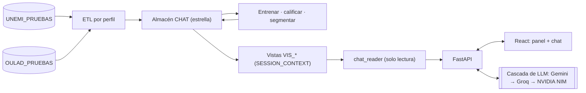

<div align="center">

### Proyecto de Titulación — Universidad Estatal de Milagro (UNEMI)

# VicMar Data AI

**Desarrollo de un modelo predictivo de abandono estudiantil mediante inteligencia de negocios y procesamiento de lenguaje natural**


**Autores:** Marlon David Pérez Almachi · Víctor Manuel Lluilema Pisco · **Año:** 2026


-CC2927?logo=microsoftsqlserver&logoColor=white)


</div>

---

Prototipo de inteligencia de negocios que **predice qué alumnos abandonarán en el próximo periodo**, explica por qué, segmenta las carreras por riesgo, compara la institución con referentes publicados y permite consultar todo en lenguaje natural, sin SQL. El panel y el chat leen las mismas vistas gobernadas, y cada institución solo ve sus propios datos, lo que está garantizado a nivel del motor de base de datos.

## Estructura del repositorio

```
├── codigo_fuente/            Todo el código, organizado por capas (ver codigo_fuente/README.md)
│   ├── frontend/             Capa de presentación: React + Vite (panel y chat)
│   ├── backend/              API FastAPI en capas: api/ → core/ + ml/ → etl/ + knowledge/
│   ├── base_de_datos/        Almacén en esquema estrella, vistas VIS_*, usuario de solo lectura y datos de prueba anonimizados
│   └── scripts/              Pipeline reproducible (demo_tesis.ps1)
├── documentacion/            Avances de titulación, generador del documento, diagramas UML, figuras,
│                             matrices, literatura (RIS), decisiones de diseño, documentación técnica y plan
└── datos/                    Cómo obtener el dataset público OULAD (no se versiona)
```

La justificación de esta estructura, con literatura científica y repositorios de referencia, está en [`documentacion/decisiones/ADR-000-estructura-del-repositorio.md`](documentacion/decisiones/ADR-000-estructura-del-repositorio.md).

## Componentes

| Pieza | Qué hace | Dónde está |
|---|---|---|
| Modelo predictivo | Panel alumno-periodo, Random Forest por institución, validación cruzada agrupada por alumno + prueba temporal, umbral por recall, factores SHAP | `codigo_fuente/backend/ml/` |
| Segmentación | K-Means por carrera, validado (silhouette, estabilidad, Kruskal-Wallis) | `codigo_fuente/backend/ml/clustering_institucional.py` |
| NL2SQL | Pregunta en español → SQL de solo lectura sobre vistas `VIS_*`, con métricas certificadas y lógica de negocio por institución | `codigo_fuente/backend/core/nl2sql_engine.py`, `codigo_fuente/backend/knowledge/` |
| Panel | Riesgo con factores y confiabilidad del modelo; segmentos; referentes con DOI | `codigo_fuente/frontend/src/components/views/` |
| ETL | Un perfil de mapeo por institución, mismo código para todas | `codigo_fuente/backend/etl/perfiles.py`, `codigo_fuente/backend/scripts/etl_academico.py` |
| Seguridad y privacidad | `chat_reader` solo lectura sobre `VIS_*`, `SESSION_CONTEXT` por institución, fail-closed; datos personales enmascarados antes de cualquier servicio externo | `codigo_fuente/base_de_datos/crear_chat_academico.sql`, `codigo_fuente/backend/main.py`, `codigo_fuente/backend/core/privacidad.py` |

## Arquitectura

Cliente-servidor desacoplado (SPA + API REST) con backend en capas y almacén de datos con aislamiento por institución en el motor:



Diagramas UML completos en `documentacion/diagramas/` y decisiones de tecnología y arquitectura en `documentacion/decisiones/`.

## Datos

- **UNEMI_PRUEBAS:** 14.508 alumnos sintéticos y anonimizados (83.678 registros alumno-semestre), en `codigo_fuente/base_de_datos/datos_de_prueba/`.
- **OULAD_UK:** Open University Learning Analytics Dataset (Kuzilek, Hlosta y Zdrahal, 2017, *Scientific Data*, CC BY 4.0), cargado como segunda institución real. Se descarga aparte: ver [`datos/README.md`](datos/README.md).

## Inicio rápido

Requisitos: Python 3.14, Node.js 20+, Docker Desktop, ODBC Driver 18 for SQL Server.

```powershell
py -3.14 -m venv codigo_fuente\backend\venv
codigo_fuente\backend\venv\Scripts\pip install -r codigo_fuente\backend\requirements.txt
cd codigo_fuente\frontend; npm install; cd ..\..
copy codigo_fuente\backend\.env.example codigo_fuente\backend\.env   # completar DB_PASSWORD, CHAT_READER_PASSWORD y claves de los proveedores de IA
copy codigo_fuente\backend\usuarios_prueba.example.json codigo_fuente\backend\usuarios_prueba.local.json   # contraseñas de los usuarios de prueba
powershell -ExecutionPolicy Bypass -File codigo_fuente\scripts\demo_tesis.ps1 -Levantar
```

`demo_tesis.ps1` reconstruye las bases, carga las dos instituciones, entrena, califica, segmenta, carga los referentes, genera el diccionario de datos y ejecuta las pruebas. Con `-ConEvaluacionNL2SQL` corre además el conjunto de 40 preguntas de referencia. El backend escucha en `http://127.0.0.1:8090` y el frontend en `http://localhost:3000`.

## Pruebas y evaluación

```powershell
cd codigo_fuente\backend
venv\Scripts\python -m pytest                 # unitarias + integración (las de integración se omiten si no hay SQL Server)
venv\Scripts\python -m eval.evaluar_nl2sql    # exactitud por ejecución del NL2SQL
```

## Documento de titulación

```powershell
cd documentacion\generador_documentos
python _build_avance2.py                      # genera documentacion/avances/Avance_2_VicMar_Data_AI.docx desde el formato oficial
powershell -ExecutionPolicy Bypass -File _docx_a_pdf.ps1 -Docx ..\avances\Avance_2_VicMar_Data_AI.docx
python _verificar_coherencia.py               # citas ↔ referencias, cifras ↔ resultados del sistema, páginas mínimas
```

Ninguna cifra del documento se escribe a mano: el generador las lee de los resultados que produce el código.

## Documentación

| Documento | Contenido |
|---|---|
| [documentacion/PLAN_Y_ESTADO_DEL_PROYECTO.md](documentacion/PLAN_Y_ESTADO_DEL_PROYECTO.md) | Estado actual, exigencias de las tutoras y pendientes |
| [documentacion/tecnica/PREDICCION_ABANDONO.md](documentacion/tecnica/PREDICCION_ABANDONO.md) | Modelo, validación y resultados |
| [documentacion/tecnica/BENCHMARKING_INSTITUCIONAL.md](documentacion/tecnica/BENCHMARKING_INSTITUCIONAL.md) | Referentes externos y segmentación |
| [documentacion/tecnica/BASE_DE_DATOS_DE_PRUEBAS.md](documentacion/tecnica/BASE_DE_DATOS_DE_PRUEBAS.md) | Bases, anonimización y reconstrucción |
| [documentacion/tecnica/DICCIONARIO_DE_DATOS.md](documentacion/tecnica/DICCIONARIO_DE_DATOS.md) | Diccionario generado desde el esquema real |
| [documentacion/tecnica/MANUAL_INSTALACION.md](documentacion/tecnica/MANUAL_INSTALACION.md) | Instalación detallada |
| [documentacion/decisiones/](documentacion/decisiones/) | Comparación de tecnologías y arquitectura (matrices y ADR) |
| [documentacion/auditoria/](documentacion/auditoria/) | Auditoría del proyecto |

Las credenciales de los usuarios de prueba se entregan aparte; no se versionan.
