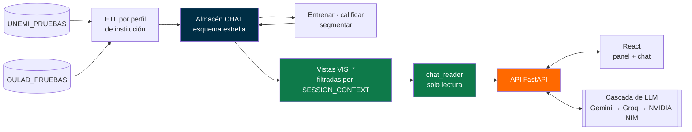

<div align="center">

```
 ██╗   ██╗███╗   ██╗███████╗███╗   ███╗██╗
 ██║   ██║████╗  ██║██╔════╝████╗ ████║██║
 ██║   ██║██╔██╗ ██║█████╗  ██╔████╔██║██║
 ██║   ██║██║╚██╗██║██╔══╝  ██║╚██╔╝██║██║
 ╚██████╔╝██║ ╚████║███████╗██║ ╚═╝ ██║██║
  ╚═════╝ ╚═╝  ╚═══╝╚══════╝╚═╝     ╚═╝╚═╝
   Universidad Estatal de Milagro · Proyecto de Titulación · 2026
```


# VicMar Data AI

### Predicción del abandono estudiantil en Instituciones de Educación Superior<br/>con inteligencia de negocios y consultas en lenguaje natural


<br/>


<br/>


**Marlon David Pérez Almachi · Víctor Manuel Lluilema Pisco**

[Qué hace](#-qué-hace) · [El modelo](#-el-modelo-predictivo) · [Resultados](#-resultados) · [Arquitectura](#-arquitectura) · [Inicio rápido](#-inicio-rápido) · [Documentación](#-documentación) · [Estado](#-estado-del-proyecto)

</div>

---

## ◆ Qué hace

Una universidad se entera de que un estudiante abandonó cuando ya no se matricula. **VicMar Data AI adelanta ese momento un periodo:** con lo que se sabe de cada alumno hasta hoy, estima la probabilidad de que abandone en el periodo siguiente, explica por qué y permite que cualquier autoridad académica lo consulte en español, sin escribir SQL.

<table>
<tr>
<td width="50%" valign="top">

**🎯 Predice**<br/>
Probabilidad de abandono en el periodo *t+1* para cada alumno activo, con un umbral elegido para detectar al menos el 80 % de los casos.

**🔍 Explica**<br/>
Los tres factores que más elevan el riesgo de cada alumno (SHAP), redactados en lenguaje natural.

**🧭 Segmenta**<br/>
Agrupa las carreras por nivel de riesgo (K-Means validado) para saber qué programas priorizar.

</td>
<td width="50%" valign="top">

**📊 Compara**<br/>
Sitúa la institución frente a referentes publicados en revistas científicas, cada uno con su DOI.

**💬 Responde**<br/>
*«¿Cuántos alumnos de Sistemas están en riesgo alto?»* → SQL de solo lectura → tabla, gráfico o cifra.

**🔒 Protege**<br/>
Cada institución solo ve sus datos, garantizado en el motor de base de datos; los datos personales se enmascaran antes de salir del sistema.

</td>
</tr>
</table>

---

## ◆ El modelo predictivo

```
  Historial del alumno hasta t          Modelo por institución             Salida para la autoridad
 ┌──────────────────────────────┐     ┌──────────────────────────┐     ┌──────────────────────────────┐
 │ promedio y su tendencia      │     │ Random Forest            │     │ p(abandono en t+1) = 0,74    │
 │ asistencia y su tendencia    │ ──▶ │ + ponderación de clases  │ ──▶ │ Riesgo: ALTO                 │
 │ mora, saldo, beca            │     │   o SMOTE                │     │ 1. promedio en descenso      │
 │ sede, modalidad, avance      │     │ umbral para recall ≥ 0,80│     │ 2. asistencia mínima 52 %    │
 └──────────────────────────────┘     └──────────────────────────┘     │ 3. dos periodos con mora     │
                                                                       └──────────────────────────────┘
```
<sub>El recuadro de salida es ilustrativo; los valores reales se calculan para cada alumno.</sub>

| Decisión | Cómo se resolvió | Por qué |
|---|---|---|
| **Unidad de análisis** | Una fila por *alumno en un periodo*; la etiqueta es si abandona en el siguiente | Predecir, no detectar: la versión anterior usaba datos del mismo periodo del retiro |
| **Sin fuga de información** | Las variables solo usan datos hasta *t*; la misma función construye el panel para entrenar y para calificar | Evita *training/serving skew* |
| **Validación** | `StratifiedGroupKFold` agrupado por alumno + 25 % más reciente reservado como prueba temporal | Un alumno nunca está a la vez en entrenamiento y prueba |
| **Comparación justa** | Random Forest frente a regresión logística y gradient boosting, con los mismos pliegues | La elección del algoritmo se sostiene con datos, no por costumbre |
| **Umbral operativo** | El mayor umbral con recall ≥ 0,80 | Para la institución es más caro no ver a un alumno en riesgo que revisar uno de más |
| **Un modelo por institución** | Nunca se mezclan datos de dos instituciones | Privacidad y patrones propios de cada una |

Detalle completo en [`documentacion/tecnica/PREDICCION_ABANDONO.md`](documentacion/tecnica/PREDICCION_ABANDONO.md).

---

## ◆ Resultados

El sistema se probó con **dos instituciones**:

| | **UNEMI_PRUEBAS** | **OULAD_UK** |
|---|---|---|
| Origen | Sintético y anonimizado | Real: *Open University Learning Analytics Dataset* (Kuzilek et al., 2017, CC BY 4.0) |
| Panel alumno-periodo | 83.678 filas · 14.508 alumnos | 189.299 filas |
| Prevalencia de abandono | 1,87 % | 2,54 % |
| Modelo final | RF + SMOTE | RF + ponderación de clases |
| ROC-AUC validación cruzada | 0,996 | **0,758** |
| ROC-AUC prueba temporal | 0,997 | **0,752** |
| ROC-AUC prospectivo (bloque siguiente, desenlace real) | — | **0,725** |
| Recall / precisión en el umbral | 0,777 / 0,990 | 0,798 / 0,052 |
| Variable más importante | asistencia | promedio |

> [!IMPORTANT]
> **Lectura honesta de las cifras.** El 0,99 de UNEMI_PRUEBAS se debe al generador sintético: la asistencia de quien abandona cae un periodo antes y esa sola variable ya separa los casos. Esa base sirve para probar la arquitectura. **El desempeño realista es el de OULAD (ROC-AUC ≈ 0,75)**, por debajo de la meta inicial de 0,90; la sección 3.3 del Avance 2 discute por qué y qué haría falta para mejorarlo.

<div align="center">

<br/><sub>Curvas ROC y precisión-recall de la prueba temporal en OULAD_UK.</sub>
</div>

### Consultas en lenguaje natural (NL2SQL)

Evaluado con **40 preguntas de referencia** y **8 ataques adversariales** sobre UNEMI_PRUEBAS, con el rol `ACADEMICO`:

| Exactitud relajada | Exactitud estricta | Adversariales bloqueados | Violaciones de aislamiento | Latencia p50 / p95 |
|:---:|:---:|:---:|:---:|:---:|
| **92,5 %** | 50 % | **8 / 8** | **0** | 28 s / 56 s |

La exactitud relajada acepta respuestas con el mismo resultado y otra forma (columnas, orden). La estricta exige el mismo resultado exacto. Tras los ataques adversariales, la base quedó sin cambios.

---

## ◆ Arquitectura

Cliente-servidor desacoplado (SPA + API REST), backend en capas y almacén en esquema estrella con aislamiento por institución en el propio motor.



**Seguridad por diseño.** El backend consulta con una cuenta que solo puede leer las vistas `VIS_*`. Cada vista se filtra con `SESSION_CONTEXT`, y sin institución en la sesión no devuelve nada (*fail-closed*). Antes de llamar a un proveedor externo, los datos personales se enmascaran.

<details>
<summary><b>Stack tecnológico y por qué se eligió</b></summary>
<br/>

| Capa | Tecnología | Alternativas evaluadas |
|---|---|---|
| Lenguaje del backend | Python 3.14 | Java, Node/TypeScript |
| Framework del backend | FastAPI 0.141 | Django, Flask |
| Frontend | React 18 + Vite | Angular, Vue |
| Almacén de datos | SQL Server 2022 (Docker) | PostgreSQL, MySQL |
| Algoritmo | Random Forest (scikit-learn) | Regresión logística, gradient boosting |
| Arquitectura | Cliente-servidor desacoplado | Monolito en capas, microservicios |

Cada decisión tiene una matriz ponderada con análisis de sensibilidad (±20 % en los pesos, sin cambio de ganador) y su ADR en [`documentacion/decisiones/`](documentacion/decisiones/). La arquitectura implementada se verifica contra reglas automáticas: 0 violaciones.

</details>

---

## ◆ Estructura del repositorio

```
├── codigo_fuente/
│   ├── frontend/          Capa de presentación · React + Vite (panel de riesgo, segmentos, referentes, chat)
│   ├── backend/           API FastAPI en capas
│   │   ├── api/             rutas HTTP
│   │   ├── core/            NL2SQL, seguridad y privacidad
│   │   ├── ml/              modelo predictivo, segmentación, reportes de validación
│   │   ├── etl/ knowledge/  perfiles por institución, catálogo de métricas certificadas
│   │   └── eval/ tests/     evaluación NL2SQL y pruebas
│   ├── base_de_datos/     Esquema estrella, vistas VIS_*, usuario de solo lectura, datos de prueba anonimizados
│   └── scripts/           Pipeline reproducible de punta a punta (demo_tesis.ps1)
├── documentacion/
│   ├── avances/           Avance 1 y Avance 2 (.docx y .pdf)
│   ├── generador_documentos/  Genera el Avance desde el formato oficial y verifica su coherencia
│   ├── diagramas/         UML: casos de uso, secuencia, actividades, estados, colaboración, modelo dimensional
│   ├── figuras/           ROC/PR, matriz de confusión, importancia, comparación CV, selección de k
│   ├── decisiones/        Matrices ponderadas y ADR de tecnología, arquitectura y estructura
│   ├── literatura/        Búsquedas Scopus en RIS · 13 trabajos previos comparados
│   ├── matrices/          Matrices metodológicas
│   ├── tecnica/           Modelo, benchmarking, base de pruebas, diccionario de datos, manual de instalación
│   └── PLAN_Y_ESTADO_DEL_PROYECTO.md
└── datos/                 Cómo obtener el dataset OULAD (no se versiona)
```

Esta organización por capas se justifica con literatura científica y repositorios de referencia en [`ADR-000`](documentacion/decisiones/ADR-000-estructura-del-repositorio.md).

---

## ◆ Inicio rápido

**Requisitos:** Python 3.14 · Node.js 20+ · Docker Desktop · ODBC Driver 18 for SQL Server

```powershell
# 1. Entorno del backend
py -3.14 -m venv codigo_fuente\backend\venv
codigo_fuente\backend\venv\Scripts\pip install -r codigo_fuente\backend\requirements.txt

# 2. Frontend
cd codigo_fuente\frontend; npm install; cd ..\..

# 3. Configuración local (no se versiona)
copy codigo_fuente\backend\.env.example codigo_fuente\backend\.env
copy codigo_fuente\backend\usuarios_prueba.example.json codigo_fuente\backend\usuarios_prueba.local.json

# 4. Todo el pipeline: bases, ETL, entrenamiento, calificación, segmentación, referentes, diccionario y pruebas
powershell -ExecutionPolicy Bypass -File codigo_fuente\scripts\demo_tesis.ps1 -Levantar
```

| Servicio | Dirección |
|---|---|
| Frontend | `http://localhost:3000` |
| API y documentación interactiva | `http://127.0.0.1:8090/docs` |
| SQL Server (Docker) | `localhost,1433` |

Con `-ConEvaluacionNL2SQL`, el script corre además las 40 preguntas de referencia.

<details>
<summary><b>Pruebas, evaluación y documento de titulación</b></summary>
<br/>

```powershell
cd codigo_fuente\backend
venv\Scripts\python -m pytest                  # unitarias + integración (las de integración se omiten sin SQL Server)
venv\Scripts\python -m eval.evaluar_nl2sql     # exactitud por ejecución del NL2SQL
venv\Scripts\python -m ml.reporte_validacion --empresa OULAD_UK   # figuras de validación

cd ..\..\documentacion\generador_documentos
python _build_avance2.py                       # genera el Avance 2 desde el formato oficial UNEMI
python _verificar_coherencia.py                # citas ↔ referencias, cifras ↔ resultados, páginas mínimas
```

Ninguna cifra del documento de titulación se escribe a mano: el generador la lee de los resultados que produce el código.

</details>

---

## ◆ Documentación

| | Documento | Contenido |
|---|---|---|
| 📘 | [Plan y estado del proyecto](documentacion/PLAN_Y_ESTADO_DEL_PROYECTO.md) | Exigencias de las tutoras, avance y pendientes |
| 🧠 | [Predicción del abandono](documentacion/tecnica/PREDICCION_ABANDONO.md) | Datos, variables, validación y resultados |
| 📊 | [Benchmarking institucional](documentacion/tecnica/BENCHMARKING_INSTITUCIONAL.md) | Referentes externos y segmentación de carreras |
| 🗄️ | [Base de datos de pruebas](documentacion/tecnica/BASE_DE_DATOS_DE_PRUEBAS.md) | Bases, anonimización y reconstrucción |
| 📖 | [Diccionario de datos](documentacion/tecnica/DICCIONARIO_DE_DATOS.md) | Generado desde el esquema real |
| 🛠️ | [Manual de instalación](documentacion/tecnica/MANUAL_INSTALACION.md) | Instalación paso a paso |
| ⚖️ | [Decisiones de diseño](documentacion/decisiones/) | Matrices ponderadas y ADR |
| 📐 | [Diagramas UML](documentacion/diagramas/) | Fuentes Mermaid y figuras |

---

## ◆ Estado del proyecto

```
 Anteproyecto ━━━━━━ Avance 1 ━━━━━━ Avance 2 ━━━━━━ Avance 3 ━━━━━━ Defensa
      ✔                 ✔               ✔                ◌               ◌
```

- [x] Modelo predictivo validado en dos instituciones, con explicación SHAP
- [x] Segmentación de carreras y comparación con referentes publicados
- [x] Consultas en lenguaje natural con aislamiento por institución
- [x] Decisiones de tecnología y arquitectura con matrices y ADR
- [x] Comparación crítica de 13 trabajos previos frente al presente caso
- [ ] Capturas y video de la demostración
- [ ] Prueba con usuarios sin perfil técnico
- [ ] Avance 3: resultados finales, conclusiones y recomendaciones

---

<div align="center">

**Universidad Estatal de Milagro** · Facultad de Ciencias e Ingenierías · Carrera de Ingeniería en Tecnologías de la Información

**Docentes tutoras:** Mirella Azucena Peralta Correa · María Gabriela Espinoza Bravo

Proyecto académico de titulación. Los datos de UNEMI_PRUEBAS son sintéticos; OULAD se usa bajo licencia CC BY 4.0.<br/>
Las credenciales de los usuarios de prueba se entregan aparte y no se versionan.

<sub>© 2026 Marlon David Pérez Almachi y Víctor Manuel Lluilema Pisco</sub>

</div>
