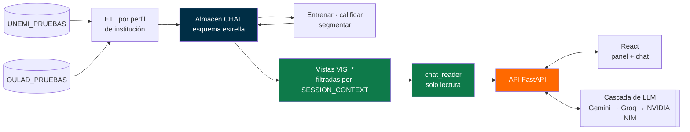

<p align="center">
  <picture>
    <source media="(prefers-color-scheme: dark)" srcset=".github/assets/banner-dark.svg">
    
  </picture>
</p>

<p align="center">
  <a href="https://github.com/Vm199524/PROYECTO-TITULACION-MARLON-VICTOR-UNEMI/actions/workflows/ci.yml"></a>
  
  <a href="CITATION.cff"></a>
  <a href="#licencia"></a>
</p>

<p align="center">
  
  
  
  
  
  
  
</p>

<p align="center">
  <b>Español</b> · <a href="README.en.md">English</a>
</p>

<p align="center">
  Una universidad se entera de que un estudiante abandonó cuando ya no se matricula.<br/>
  <b>VicMar Data AI adelanta ese momento un periodo</b>: estima quién está en riesgo, explica por qué<br/>
  y deja que cualquier autoridad académica lo consulte en español, sin escribir SQL.
</p>

<p align="center">
  <a href="#qué-hace">Qué hace</a> ·
  <a href="#cómo-funciona-el-modelo">El modelo</a> ·
  <a href="#resultados">Resultados</a> ·
  <a href="#arquitectura">Arquitectura</a> ·
  <a href="#inicio-rápido">Inicio rápido</a> ·
  <a href="#documentación">Documentación</a> ·
  <a href="#cómo-citar">Cómo citar</a>
</p>

---

## Qué hace

<table>
<tr>
<td width="33%" valign="top">

### 🎯 Predice
La probabilidad de que cada alumno activo abandone en el **periodo siguiente**, con un umbral elegido para detectar al menos el 80 % de los casos.

</td>
<td width="33%" valign="top">

### 🔍 Explica
Los **tres factores** que más elevan el riesgo de cada alumno (SHAP), redactados en lenguaje natural para quien toma la decisión.

</td>
<td width="33%" valign="top">

### 🧭 Segmenta
Agrupa las carreras por nivel de riesgo (K-Means validado) para saber **qué programas priorizar**.

</td>
</tr>
<tr>
<td valign="top">

### 📊 Compara
Sitúa a la institución frente a **referentes publicados** en revistas científicas, cada uno con su DOI.

</td>
<td valign="top">

### 💬 Responde
*«¿Cuántos alumnos de Sistemas están en riesgo alto?»* → SQL de solo lectura → tabla, gráfico o cifra.

</td>
<td valign="top">

### 🔒 Protege
Cada institución ve **solo sus datos**, garantizado en el propio motor de base de datos. Los datos personales se enmascaran antes de salir del sistema.

</td>
</tr>
</table>

## Cómo funciona el modelo

```
  Historial del alumno hasta t          Modelo por institución             Salida para la autoridad
 ┌──────────────────────────────┐     ┌──────────────────────────┐     ┌──────────────────────────────┐
 │ promedio y su tendencia      │     │ Random Forest            │     │ p(abandono en t+1) = 0,74    │
 │ asistencia y su tendencia    │ ──▶ │ + ponderación de clases  │ ──▶ │ Riesgo: ALTO                 │
 │ mora, saldo, beca            │     │   o SMOTE                │     │ 1. promedio en descenso      │
 │ sede, modalidad, avance      │     │ umbral para recall ≥ 0,80│     │ 2. asistencia mínima 52 %    │
 └──────────────────────────────┘     └──────────────────────────┘     │ 3. dos periodos con mora     │
                                                                       └──────────────────────────────┘
```
<sub>La salida es ilustrativa; los valores reales se calculan para cada alumno.</sub>

| Decisión | Cómo se resolvió | Por qué |
|---|---|---|
| **Unidad de análisis** | Una fila por *alumno en un periodo*; la etiqueta es si abandona en el siguiente | Predecir, no detectar: una versión anterior usaba datos del mismo periodo del retiro |
| **Sin fuga de información** | Las variables solo usan datos hasta *t*; una misma función arma el panel para entrenar y para calificar | Evita la diferencia entre entrenamiento y uso (*training/serving skew*) |
| **Validación** | `StratifiedGroupKFold` agrupado por alumno + el 25 % más reciente reservado como prueba temporal | Un alumno nunca está a la vez en entrenamiento y en prueba |
| **Comparación justa** | Random Forest frente a regresión logística y *gradient boosting*, con los mismos pliegues | La elección del algoritmo se sostiene con datos |
| **Umbral operativo** | El mayor umbral con recall ≥ 0,80 | No ver a un alumno en riesgo cuesta más que revisar uno de más |
| **Un modelo por institución** | Nunca se mezclan datos de dos instituciones | Privacidad y patrones propios de cada una |

## Resultados

Probado con **dos instituciones**: una sintética, para validar la arquitectura, y una real, para medir el desempeño.

| | **UNEMI_PRUEBAS** | **OULAD_UK** |
|---|:---:|:---:|
| Origen | Sintético y anonimizado | Real · *Open University Learning Analytics Dataset* (Kuzilek et al., 2017, CC BY 4.0) |
| Panel alumno-periodo | 83.678 filas · 14.508 alumnos | 189.299 filas |
| Prevalencia de abandono | 1,87 % | 2,54 % |
| Modelo final | RF + SMOTE | RF + ponderación de clases |
| ROC-AUC · validación cruzada | 0,996 | **0,758** |
| ROC-AUC · prueba temporal | 0,997 | **0,752** |
| ROC-AUC · prospectivo (desenlace real posterior) | — | **0,725** |
| Recall / precisión en el umbral | 0,777 / 0,990 | 0,798 / 0,052 |
| Variable más importante | asistencia | promedio |

> [!IMPORTANT]
> **Lectura honesta de las cifras.** El 0,99 de UNEMI_PRUEBAS lo produce el generador sintético: la asistencia de quien abandona cae un periodo antes y esa sola variable ya separa los casos. **El desempeño realista es el de OULAD (ROC-AUC ≈ 0,75)**, por debajo de la meta inicial de 0,90. La sección 3.3 del Avance 2 discute por qué y qué haría falta para mejorarlo.

<table>
<tr>
<td width="60%"></td>
<td width="40%"></td>
</tr>
<tr>
<td align="center"><sub>ROC y precisión-recall: la validación cruzada y la prueba temporal coinciden, sin señales de sobreajuste.</sub></td>
<td align="center"><sub>En datos reales pesa el rendimiento académico más que la asistencia.</sub></td>
</tr>
</table>

### Consultas en lenguaje natural (NL2SQL)

**40 preguntas de referencia** y **8 ataques adversariales** sobre UNEMI_PRUEBAS, con el rol `ACADEMICO`:

| Exactitud relajada | Exactitud estricta | Ataques bloqueados | Violaciones de aislamiento | Latencia p50 / p95 |
|:---:|:---:|:---:|:---:|:---:|
| **92,5 %** | 50 % | **8 / 8** | **0** | 28 s / 56 s |

<sub>La exactitud relajada acepta el mismo resultado con otra forma (columnas u orden). La estricta exige coincidencia exacta. Después de los ataques, la base quedó sin cambios.</sub>

## Arquitectura

Cliente-servidor desacoplado (SPA + API REST), backend en capas y almacén en esquema estrella con aislamiento por institución en el propio motor.



**Seguridad por diseño.** El backend consulta con una cuenta que solo puede leer las vistas `VIS_*`. Cada vista se filtra con `SESSION_CONTEXT`; sin institución en la sesión no devuelve nada (*fail-closed*). Antes de llamar a un proveedor externo, los datos personales se enmascaran.

<details>
<summary><b>Stack tecnológico y alternativas evaluadas</b></summary>
<br/>

| Capa | Elegida | Alternativas comparadas |
|---|---|---|
| Lenguaje del backend | Python 3.14 | Java, Node/TypeScript |
| Framework del backend | FastAPI 0.141 | Django, Flask |
| Frontend | React 18 + Vite | Angular, Vue |
| Almacén de datos | SQL Server 2022 (Docker) | PostgreSQL, MySQL |
| Algoritmo | Random Forest (scikit-learn) | Regresión logística, *gradient boosting* |
| Arquitectura | Cliente-servidor desacoplado | Monolito en capas, microservicios |

Cada decisión tiene una matriz ponderada con análisis de sensibilidad (±20 % en los pesos sin cambio de ganador) y su ADR en [`documentacion/decisiones/`](documentacion/decisiones/). La arquitectura implementada se verifica contra reglas automáticas: 0 violaciones.

</details>

## Inicio rápido

**Requisitos:** Python 3.14 · Node.js 22+ · Docker Desktop · ODBC Driver 18 for SQL Server

```powershell
# 1. Backend
py -3.14 -m venv codigo_fuente\backend\venv
codigo_fuente\backend\venv\Scripts\pip install -r codigo_fuente\backend\requirements.txt

# 2. Frontend
cd codigo_fuente\frontend; npm install; cd ..\..

# 3. Configuración local (no se versiona)
copy codigo_fuente\backend\.env.example codigo_fuente\backend\.env
copy codigo_fuente\backend\usuarios_prueba.example.json codigo_fuente\backend\usuarios_prueba.local.json

# 4. Pipeline completo: bases, ETL, entrenamiento, calificación, segmentación, referentes, diccionario y pruebas
powershell -ExecutionPolicy Bypass -File codigo_fuente\scripts\demo_tesis.ps1 -Levantar
```

| Servicio | Dirección |
|---|---|
| Aplicación | `http://localhost:3000` |
| API y documentación interactiva | `http://127.0.0.1:8090/docs` |
| SQL Server (Docker) | `localhost,1433` |

<details>
<summary><b>Pruebas, evaluación y documento de titulación</b></summary>
<br/>

```powershell
cd codigo_fuente\backend
venv\Scripts\python -m pytest                                    # unitarias + integración (las de integración se omiten sin SQL Server)
venv\Scripts\python -m eval.evaluar_nl2sql                       # exactitud del NL2SQL con las 40 preguntas de referencia
venv\Scripts\python -m ml.reporte_validacion --empresa OULAD_UK  # figuras de validación

cd ..\frontend
npm test                                                         # pruebas del frontend (vitest)

cd ..\..\documentacion\generador_documentos
python _build_avance2.py                                         # genera el Avance 2 desde el formato oficial UNEMI
python _verificar_coherencia.py                                  # citas ↔ referencias, cifras ↔ resultados, páginas mínimas
```

Las pruebas del backend y del frontend, y el *build*, corren en GitHub Actions con cada cambio. Ninguna cifra del documento de titulación se escribe a mano: el generador la lee de los resultados que produce el código.

</details>

<details>
<summary><b>Estructura del repositorio</b></summary>
<br/>

```
├── codigo_fuente/
│   ├── frontend/              Presentación · React + Vite (panel de riesgo, segmentos, referentes, chat)
│   ├── backend/               API FastAPI en capas
│   │   ├── api/                 rutas HTTP
│   │   ├── core/                NL2SQL, seguridad y privacidad
│   │   ├── ml/                  modelo predictivo, segmentación, reportes de validación
│   │   ├── etl/ knowledge/      perfiles por institución, catálogo de métricas certificadas
│   │   └── eval/ tests/         evaluación NL2SQL y pruebas
│   ├── base_de_datos/         Esquema estrella, vistas VIS_*, usuario de solo lectura, datos de prueba anonimizados
│   └── scripts/               Pipeline reproducible de punta a punta (demo_tesis.ps1)
├── documentacion/
│   ├── avances/               Avance 1 y Avance 2 (.docx y .pdf)
│   ├── generador_documentos/  Genera el Avance desde el formato oficial y verifica su coherencia
│   ├── diagramas/             UML: casos de uso, secuencia, actividades, estados, colaboración, modelo dimensional
│   ├── figuras/               ROC/PR, matriz de confusión, importancia, comparación CV, selección de k
│   ├── decisiones/            Matrices ponderadas y ADR de tecnología, arquitectura y estructura
│   ├── literatura/            Búsquedas Scopus (RIS) · 13 trabajos previos comparados
│   ├── matrices/              Matrices metodológicas
│   ├── tecnica/               Modelo, benchmarking, base de pruebas, diccionario de datos, instalación
│   └── PLAN_Y_ESTADO_DEL_PROYECTO.md
└── datos/                     Cómo obtener el dataset OULAD (no se versiona)
```

La organización por capas se justifica con literatura científica y repositorios de referencia en [`ADR-000`](documentacion/decisiones/ADR-000-estructura-del-repositorio.md).

</details>

## Documentación

| Documento | Contenido |
|---|---|
| [Plan y estado del proyecto](documentacion/PLAN_Y_ESTADO_DEL_PROYECTO.md) | Exigencias de las tutoras, avance y pendientes |
| [Predicción del abandono](documentacion/tecnica/PREDICCION_ABANDONO.md) | Datos, variables, validación y resultados |
| [Benchmarking institucional](documentacion/tecnica/BENCHMARKING_INSTITUCIONAL.md) | Referentes externos y segmentación de carreras |
| [Base de datos de pruebas](documentacion/tecnica/BASE_DE_DATOS_DE_PRUEBAS.md) | Bases, anonimización y reconstrucción |
| [Diccionario de datos](documentacion/tecnica/DICCIONARIO_DE_DATOS.md) | Generado desde el esquema real |
| [Manual de instalación](documentacion/tecnica/MANUAL_INSTALACION.md) | Instalación paso a paso |
| [Decisiones de diseño](documentacion/decisiones/) | Matrices ponderadas y ADR |
| [Diagramas UML](documentacion/diagramas/) | Fuentes Mermaid y figuras |

## Estado del proyecto

```
 Anteproyecto ━━━━━━ Avance 1 ━━━━━━ Avance 2 ━━━━━━ Avance 3 ━━━━━━ Defensa
      ✔                 ✔               ✔                ◌               ◌
```

- [x] Modelo predictivo validado en dos instituciones, con explicación SHAP
- [x] Segmentación de carreras y comparación con referentes publicados
- [x] Consultas en lenguaje natural con aislamiento por institución
- [x] Decisiones de tecnología y arquitectura con matrices y ADR
- [x] Comparación crítica de 13 trabajos previos frente al presente caso
- [x] Pruebas automáticas del backend y del frontend en GitHub Actions
- [ ] Capturas y video de la demostración
- [ ] Prueba con usuarios sin perfil técnico
- [ ] Avance 3: resultados finales, conclusiones y recomendaciones

## Cómo citar

GitHub muestra el botón **«Cite this repository»** a partir de [`CITATION.cff`](CITATION.cff). En APA 7:

> Pérez Almachi, M. D., y Lluilema Pisco, V. M. (2026). *VicMar Data AI: modelo predictivo de abandono estudiantil mediante inteligencia de negocios y procesamiento de lenguaje natural* (Versión avance-2) [Software]. Universidad Estatal de Milagro. https://github.com/Vm199524/PROYECTO-TITULACION-MARLON-VICTOR-UNEMI

## Licencia

Mientras dure el proceso de titulación, este repositorio es privado y su uso está restringido a los autores, las docentes tutoras y la Universidad Estatal de Milagro. La licencia definitiva la establecerá el Departamento Legal de la UNEMI al liberar el proyecto.

Los datos de UNEMI_PRUEBAS son sintéticos. OULAD se usa bajo licencia CC BY 4.0 y no se redistribuye en este repositorio.

---

<p align="center">
  <b>Universidad Estatal de Milagro</b><br/>
  Facultad de Ciencias e Ingenierías · Carrera de Ingeniería en Tecnologías de la Información<br/>
  Docentes tutoras: Mirella Azucena Peralta Correa · María Gabriela Espinoza Bravo
</p>

<p align="center">
  <sub>© 2026 Marlon David Pérez Almachi y Víctor Manuel Lluilema Pisco</sub>
</p>
