<a id="readme-top"></a>

<p align="center">
  <picture>
    <source media="(prefers-color-scheme: dark)" srcset=".github/assets/banner-dark.svg">
    
  </picture>
</p>

<p align="center">
  <a href="https://github.com/Vm199524/PROYECTO-TITULACION-MARLON-VICTOR-UNEMI/actions/workflows/ci.yml"></a>
  
  <a href="CITATION.cff"></a>
  <a href="#licencia"></a>
</p>

<p align="center">
  
  
  
  
  
  
  
</p>

<p align="center"><b>Español</b> · <a href="README.en.md">English</a></p>

<p align="center">
  <br/>
  <sub><b>VICMAR</b> · ALERTA TEMPRANA DE ABANDONO</sub>
</p>

<p align="center">
  Una universidad suele enterarse de que un estudiante abandonó cuando ya no se matricula.<br/>
  <b>VicMar adelanta ese momento un periodo</b>: estima quién está en riesgo, explica por qué,<br/>
  ayuda a registrar el acompañamiento y permite preguntar por cualquier cifra en español, sin escribir SQL.
</p>

<p align="center">
  <a href="#qué-hace">Qué hace</a> ·
  <a href="#novedades-de-la-versión-3">Versión 3</a> ·
  <a href="#identidad-visual">Identidad</a> ·
  <a href="#el-sistema-en-acción">En acción</a> ·
  <a href="#cómo-funciona">Cómo funciona</a> ·
  <a href="#resultados">Resultados</a> ·
  <a href="#arquitectura">Arquitectura</a> ·
  <a href="#protección-de-datos">Protección de datos</a> ·
  <a href="#instalación">Instalación</a> ·
  <a href="#documentación">Documentación</a> ·
  <a href="#autores">Autores</a>
</p>

<p align="center">
  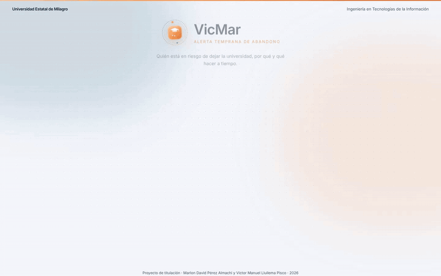
  <br/><sub>Apertura del sistema: el emblema dibuja la trayectoria del estudiante, enciende la alerta temprana y presenta las seis capacidades alrededor del ingreso.</sub>
</p>

> **Proyecto de titulación.** *Prototipo de un sistema web para predecir el abandono en estudiantes universitarios mediante aprendizaje automático y consulta conversacional.* Ingeniería en Tecnologías de la Información, Facultad de Ciencias e Ingenierías, Universidad Estatal de Milagro (UNEMI), 2026.

---

## Qué hace

<table>
<tr>
<td width="33%" valign="top">

### 🎯 Predice
La probabilidad calibrada de que cada estudiante activo **abandone en el periodo siguiente**, con umbrales de riesgo medio y alto fijados por recall (0,80 y 0,50).

</td>
<td width="33%" valign="top">

### 🔍 Explica
Las **tres razones** que más elevan el riesgo de cada estudiante (SHAP), en español, más un **simulador** «¿qué pasaría si…?» y acciones sugeridas.

</td>
<td width="33%" valign="top">

### 🤝 Acompaña
Bienestar estudiantil **registra y cierra** tutorías, consejerías, apoyos económicos y derivaciones desde la ficha de cada estudiante.

</td>
</tr>
<tr>
<td valign="top">

### 💬 Responde
*«¿Qué carreras tienen más estudiantes en riesgo?»* se resuelve con una de **40 métricas certificadas**; si no hay coincidencia, el SQL generado se valida antes de ejecutarse.

</td>
<td valign="top">

### 🧭 Prioriza carreras
Agrupa las carreras con **K-means** (validado con silueta, remuestreo y Kruskal-Wallis) para saber dónde concentrar recursos.

</td>
<td valign="top">

### 🔒 Protege
Cada institución ve **solo sus datos**, garantizado en SQL Server con `SESSION_CONTEXT` y cuentas de mínimo privilegio, conforme a la **LOPDP**.

</td>
</tr>
</table>

## Novedades de la versión 3

La versión 3 consolida el enfoque académico: todo el sistema, de la base de datos a la interfaz, está pensado para la **alerta temprana del abandono estudiantil** y se escaló en cada capa:

| Ámbito | Versión 3 |
|---|---|
| Enfoque | Estudiantes, carreras, periodos y bienestar estudiantil; varias instituciones en un mismo almacén, aisladas en el motor |
| Modelo | Panel estudiante-periodo, cuatro algoritmos comparados, LightGBM con Optuna, calibración de Platt, umbrales por recall, SHAP y monitoreo de deriva (PSI) |
| Validación | Cruzada agrupada por estudiante, temporal y prospectiva con datos reales (OULAD) |
| Consulta | 40 métricas certificadas, cascada de cuatro proveedores de IA y validación del árbol SQL; la IA nunca escribe ni lee otra institución |
| Usuarios | Tres roles (autoridad académica, bienestar estudiantil y administración de TI), capacidades por rol, auditoría y bloqueo por intentos |
| Interfaz | Identidad propia (isotipo animado en naranja UNEMI), apertura con las seis capacidades, panel ejecutivo, ficha con simulador, seguimiento, reportes PDF y Excel, tema claro y oscuro, versión móvil |
| Operación del modelo | Great Expectations valida los datos antes de entrenar, Evidently mide la deriva, MLflow registra cada entrenamiento y Metabase ofrece consulta agregada sin datos personales |
| Validación por periodo | Origen móvil (*backtesting*) y métricas por periodo y por carrera, visibles en la página Calidad del modelo |
| Gobierno de datos | Documento LOPDP con roles, ciclo de vida e incidentes, y `anonimizar_carrera.py` (seudónimos HMAC y k-anonimato) para validar con una carrera real |
| Operación | `reconstruir_sistema.bat` deja todo listo de punta a punta; 178 pruebas del backend (8 de integración con SQL Server) y 11 de la interfaz |

## Identidad visual

<table>
<tr>
<td width="140" align="center"></td>
<td>

El isotipo es una ficha en el **naranja de la UNEMI** que resume lo que hace el sistema:
- el **birrete** es la meta, titularse;
- la **línea quebrada** es la trayectoria del estudiante, periodo a periodo;
- el **punto que late** al final de la trayectoria es la alerta temprana, que se enciende antes de que la trayectoria se corte.

En la aplicación la ficha gira sobre su eje y muestra en el dorso ondas de detección; la apertura dibuja la trayectoria y enciende la alerta. Todas las animaciones se apagan si el equipo tiene activado «reducir movimiento». El nombre une a sus autores: **Vic**tor y **Mar**lon.

</td>
</tr>
</table>

## El sistema en acción

<p align="center">
  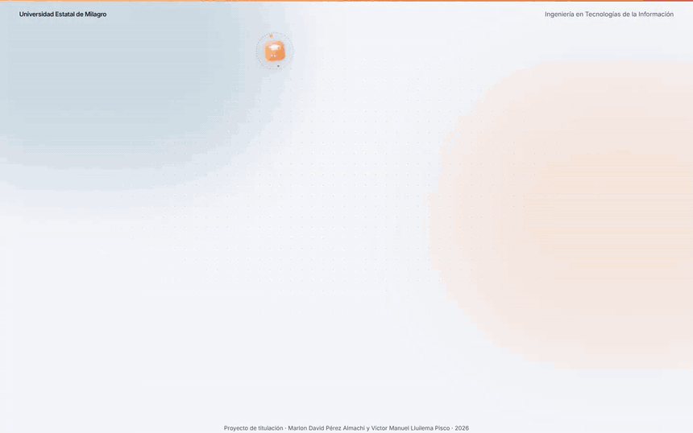
  <br/><sub>Recorrido de bienestar estudiantil: ingreso, panel ejecutivo, lista priorizada y ficha con acciones sugeridas y simulador «¿qué pasaría si…?».</sub>
</p>

<p align="center">
  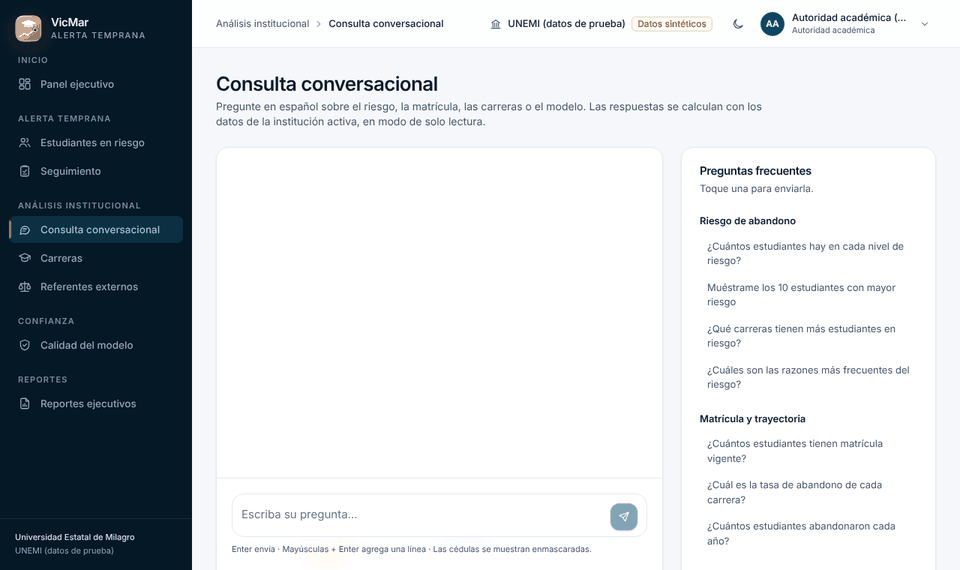
  <br/><sub>Consulta conversacional: la pregunta se resuelve con una métrica certificada y vuelve como gráfico, tabla y resumen.</sub>
</p>

<table>
<tr>
<td width="50%" align="center">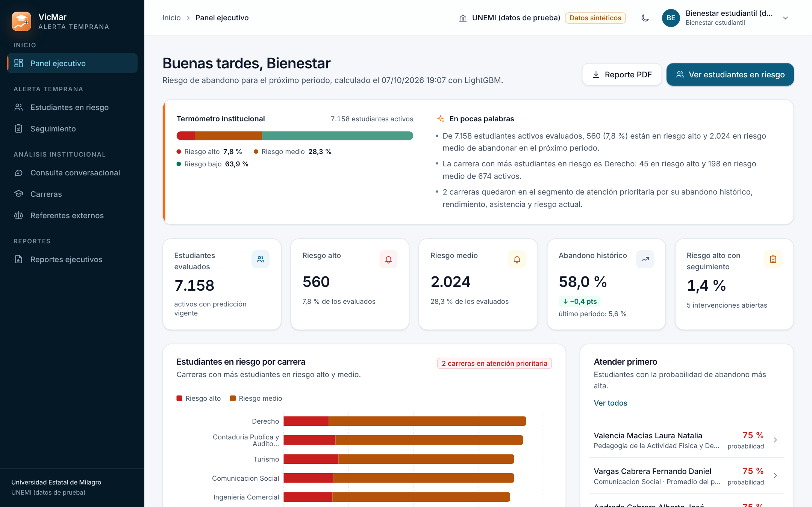<br/><sub><b>Panel ejecutivo:</b> termómetro institucional y lectura del periodo</sub></td>
<td width="50%" align="center">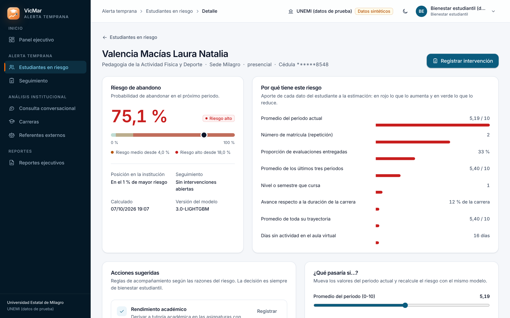<br/><sub><b>Ficha:</b> probabilidad, razones, simulador y acciones</sub></td>
</tr>
<tr>
<td align="center">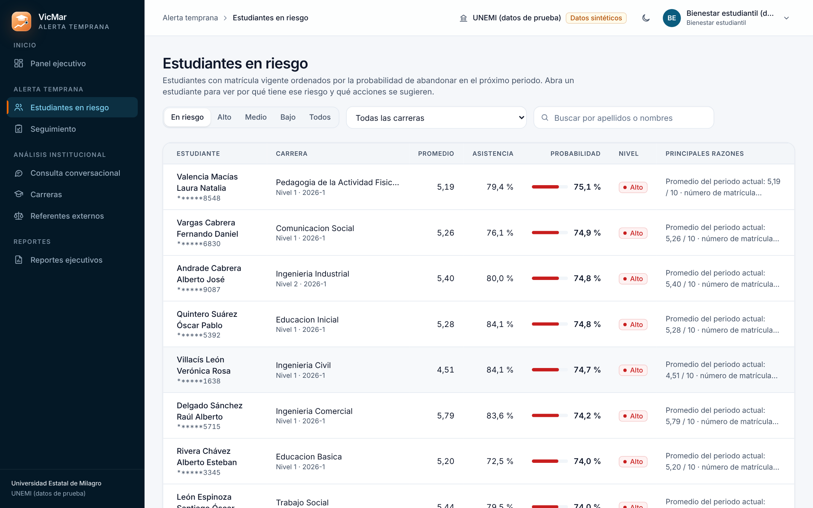<br/><sub><b>Lista priorizada</b> por probabilidad, con filtros</sub></td>
<td align="center">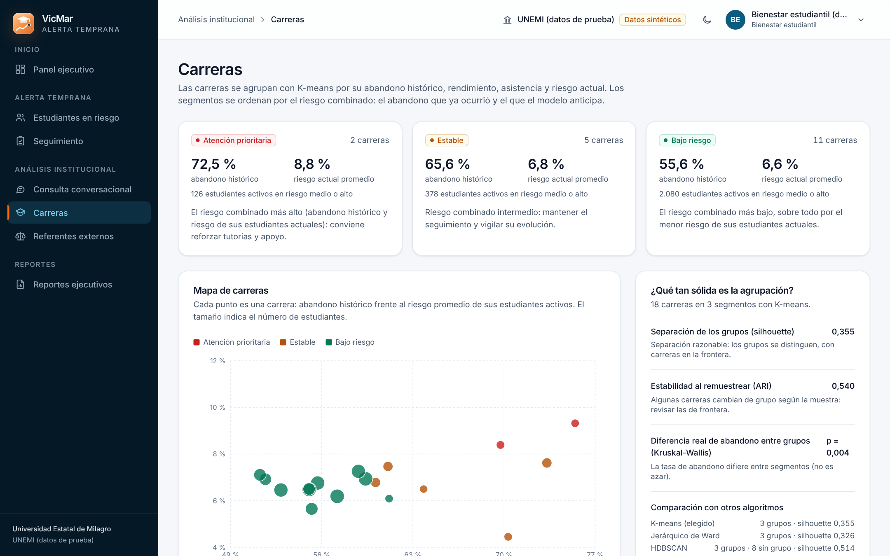<br/><sub><b>Carreras:</b> segmentos y solidez de la agrupación</sub></td>
</tr>
<tr>
<td align="center">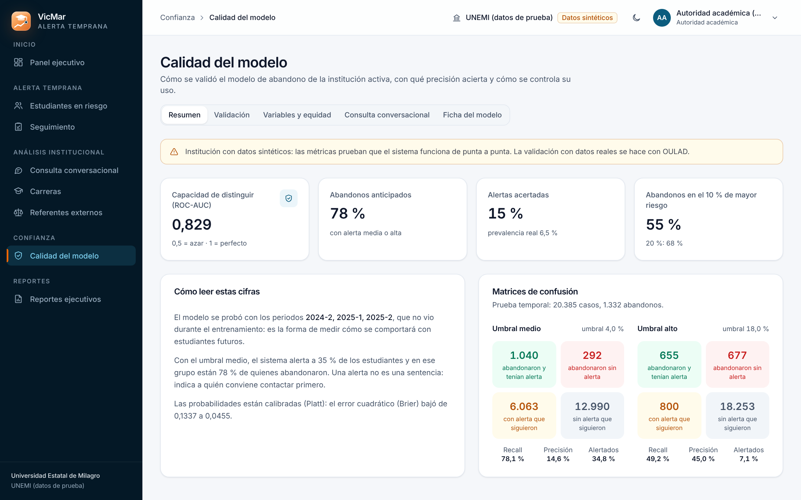<br/><sub><b>Calidad del modelo</b> explicada a la autoridad</sub></td>
<td align="center">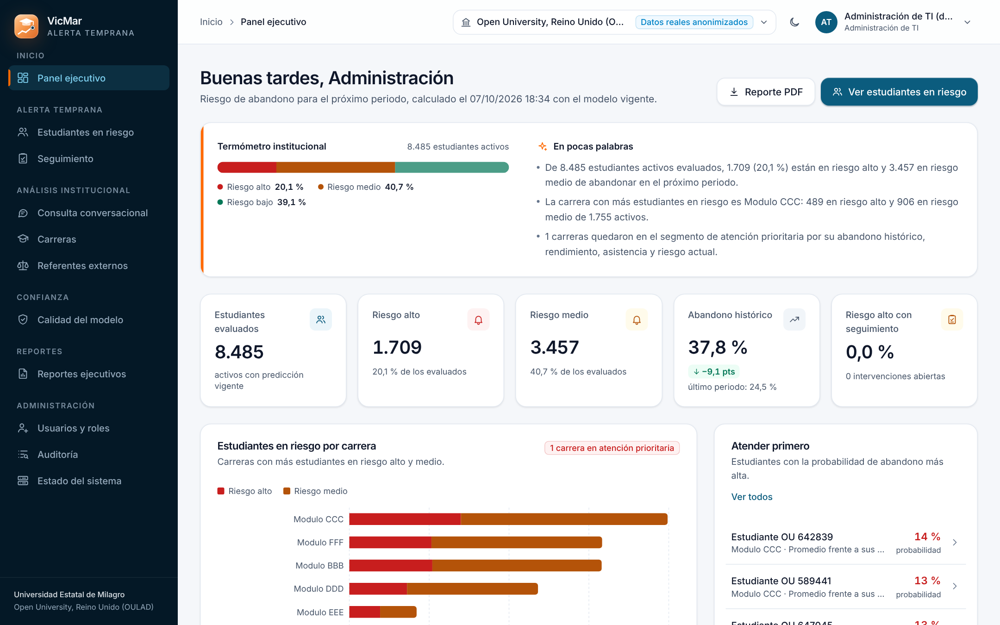<br/><sub><b>Datos reales (OULAD):</b> mismo sistema, otra institución</sub></td>
</tr>
<tr>
<td align="center">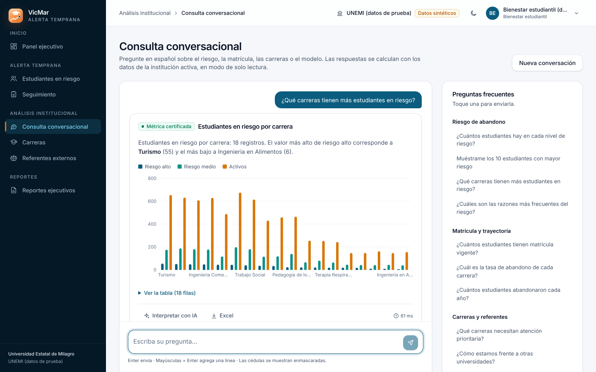<br/><sub><b>Consulta conversacional:</b> origen de la respuesta siempre visible</sub></td>
<td align="center">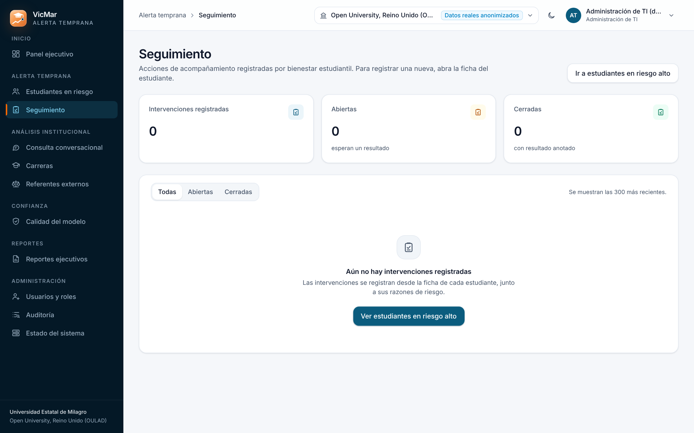<br/><sub><b>Seguimiento</b> de tutorías, consejerías y apoyos</sub></td>
</tr>
<tr>
<td align="center">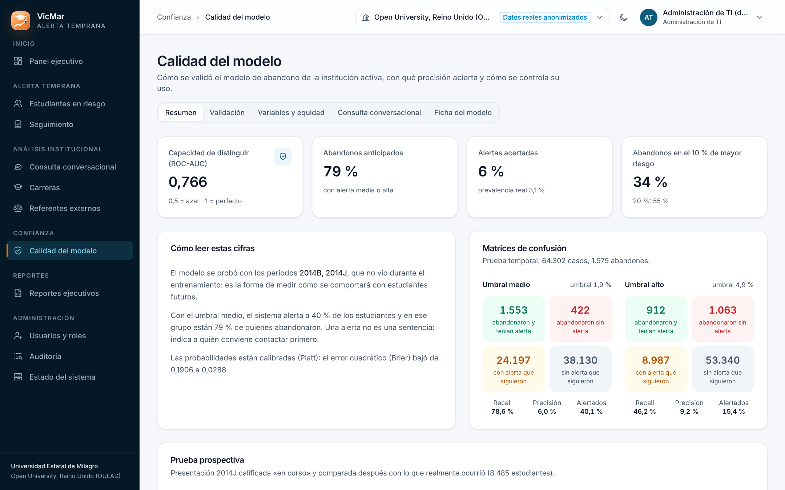<br/><sub><b>Calidad con datos reales:</b> validación prospectiva de OULAD</sub></td>
<td align="center">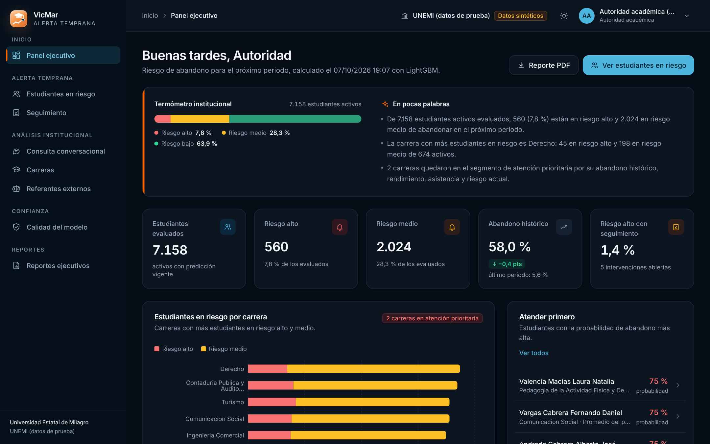<br/><sub><b>Tema oscuro</b></sub></td>
</tr>
<tr>
<td align="center">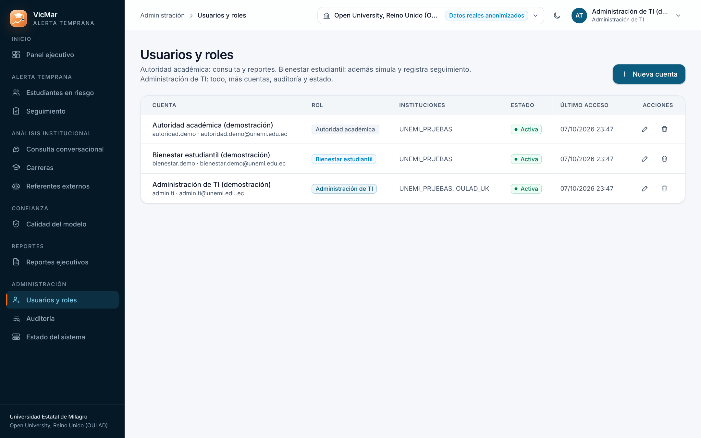<br/><sub><b>Usuarios y roles</b> con instituciones asignadas</sub></td>
<td align="center">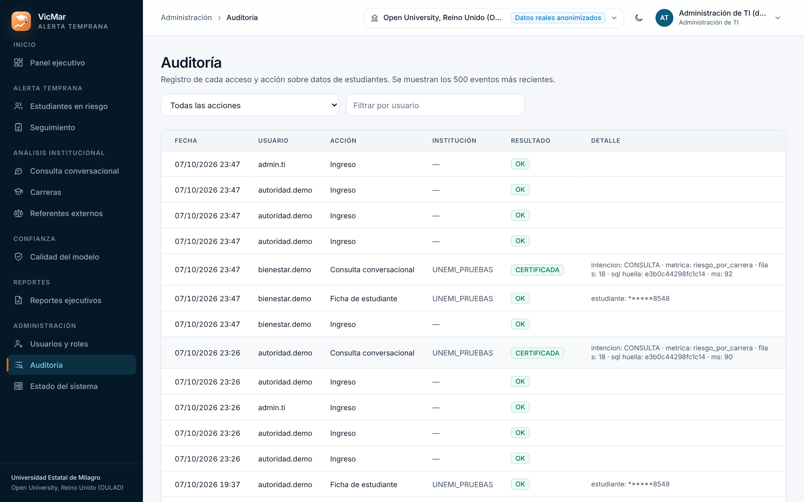<br/><sub><b>Auditoría</b> de ingresos, fichas y consultas</sub></td>
</tr>
<tr>
<td colspan="2" align="center">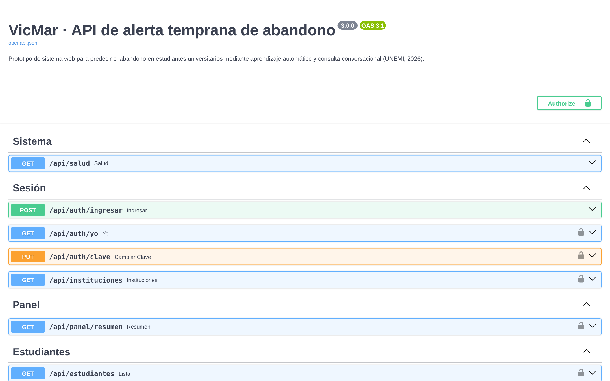<br/><sub><b>API REST</b> documentada en <code>/docs</code> (27 servicios)</sub></td>
</tr>
</table>

<p align="center">
  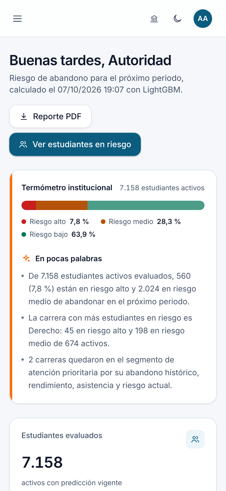
  &nbsp;&nbsp;
  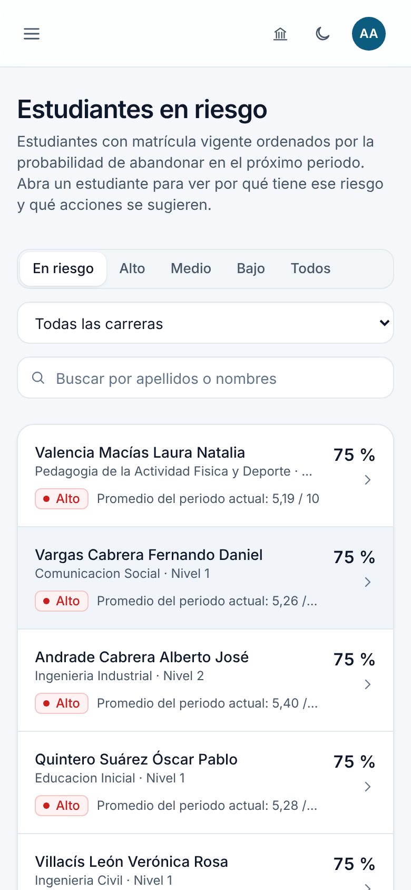
  <br/><sub>La misma aplicación en el teléfono.</sub>
</p>

## Cómo funciona

El proyecto sigue **CRISP-DM**. La unidad de análisis es el **estudiante en un periodo**: cada fila describe lo que se sabía al cierre del periodo *t* y la etiqueta indica si se retiró en *t + 1* (graduarse o egresar no cuenta como abandono).

| Etapa | Qué se hace | Código |
|---|---|---|
| Datos | Cada institución entra con un **perfil de mapeo**; el ETL valida el contrato y la calidad y carga el esquema estrella | `etl/perfiles.py`, `etl/` |
| Variables | Trayectoria (promedio y asistencia actuales, rezagados, tendencias, posición en la cohorte), cartera, matrícula, aula virtual y evaluaciones; solo lo conocido al cierre de *t* | `ml/caracteristicas.py` |
| Modelos | Regresión logística, Random Forest con pesos, Random Forest con SMOTE y LightGBM ajustado con Optuna | `ml/entrenar.py` |
| Validación | Cruzada de 5 pliegues **agrupada por estudiante**, **temporal** (periodos más recientes) y **prospectiva** (OULAD 2014J) | `ml/entrenar.py`, `ml/reporte_validacion.py` |
| Calibración | Platt sobre predicciones fuera de pliegue; umbrales por recall objetivo | `ml/entrenar.py` |
| Explicación | Valores SHAP por estudiante y monitoreo de deriva (PSI) | `ml/calificar.py` |
| Segmentación | K-means de carreras con barrido de *k*, estabilidad (ARI) y comparación con Ward y HDBSCAN | `ml/segmentar.py` |
| Consulta | Barreras → enrutador TF-IDF sobre 40 métricas certificadas → cascada de LLM (Gemini, Groq, NVIDIA NIM, DeepSeek) → validación del árbol SQL con `sqlglot` → una corrección | `nl2sql/` |

<p align="center">
  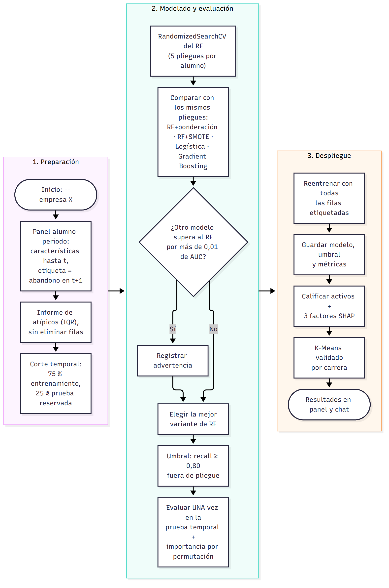
</p>

## Resultados

Cifras leídas de [`ml/modelos/*/metricas.json`](backend/ml/modelos). **UNEMI_PRUEBAS** son datos de prueba **sintéticos** con la estructura de la UNEMI (14.508 estudiantes, 2019-1 a 2026-1); **OULAD** son datos **reales anonimizados** de la Open University (Kuzilek et al., 2017).

| Métrica (prueba temporal) | UNEMI_PRUEBAS | OULAD (real) |
|---|---|---|
| Modelo elegido (mayor ROC-AUC en validación cruzada) | LightGBM (0,828 ± 0,003) | LightGBM (0,804 ± 0,012) |
| ROC-AUC | **0,829** | **0,768** |
| PR-AUC (prevalencia) | 0,466 (0,065) | 0,104 (0,031) |
| Recall en el umbral medio | 0,781 | 0,787 |
| Abandonos en el 20 % de mayor riesgo | 67,9 % | 55,4 % |
| Brier sin calibrar → calibrado | 0,134 → 0,046 | 0,192 → 0,029 |
| **Origen móvil** (cada periodo predicho solo con el pasado) | 0,827 a 0,836 (4 periodos) | 0,742 a 0,779 (2 periodos) |
| **Evaluación prospectiva** (2014J, desenlace real nunca cargado) | | **ROC-AUC 0,764 · recall 0,913** |

- **Segmentación (UNEMI_PRUEBAS):** 18 carreras en 3 segmentos; silueta 0,355; ARI medio 0,540; Kruskal-Wallis *p* = 0,004.
- **Consulta conversacional** (SQL Server 2022 con proveedores de IA, 52 preguntas del conjunto dorado): exactitud por ejecución de 100 % (65 % de las preguntas base con coincidencia exacta de columnas); 33 respondidas por métricas certificadas y 19 por SQL generado y validado; 8/8 preguntas maliciosas contenidas; 0 lecturas de otra institución; mediana de respuesta de 77 ms.

> El Avance 1 informaba un ROC-AUC de 0,9999 con datos generados por reglas deterministas. El simulador actual usa factores latentes y un componente no observable, y la validación respeta el orden del tiempo: los valores son más modestos y comparables con un uso real.

## Arquitectura

Cliente-servidor desacoplado con backend en capas, elegido frente al monolito y a los microservicios con seis escenarios de calidad ([DT-06](documentacion/decisiones/DT-06_arquitectura.json)).

<p align="center">
  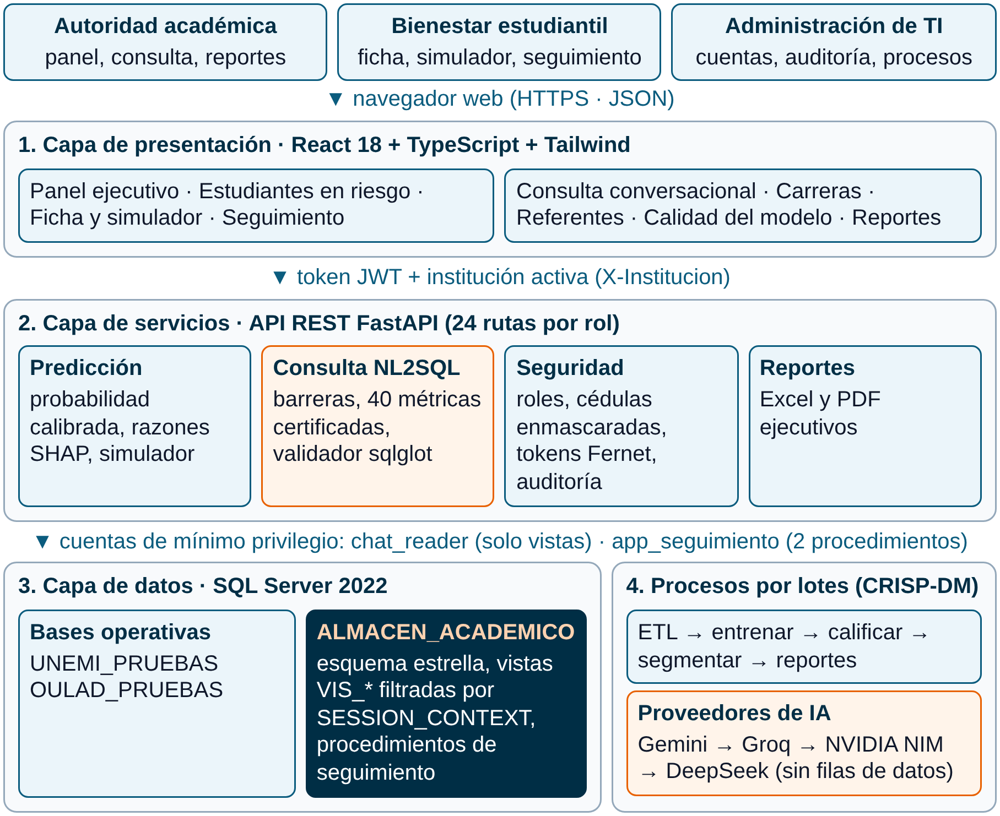
</p>

| Capa | Componentes |
|---|---|
| Datos | Bases operativas por institución · `ALMACEN_ACADEMICO` (esquema estrella, vistas `VIS_*`, procedimientos de seguimiento) en SQL Server 2022 |
| Analítica (lotes) | ETL por perfil · entrenamiento y validación · calificación con SHAP y PSI · segmentación · exploración |
| Servicios | API FastAPI (27 servicios REST): JWT, roles, auditoría, privacidad, consulta conversacional, reportes PDF y Excel |
| Presentación | React 18 + TypeScript + Vite + Tailwind + TanStack Query + Recharts; tema claro y oscuro; diseño adaptable |

<details>
<summary><b>Diagramas UML y modelo de datos</b></summary>

| | |
|---|---|
| 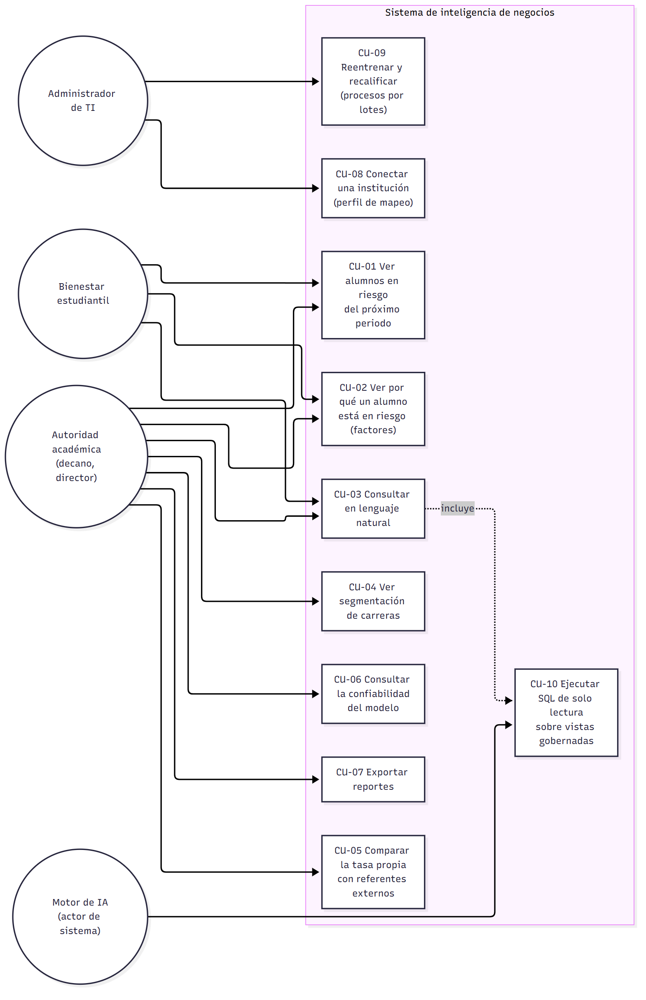<br/><sub>Casos de uso</sub> | 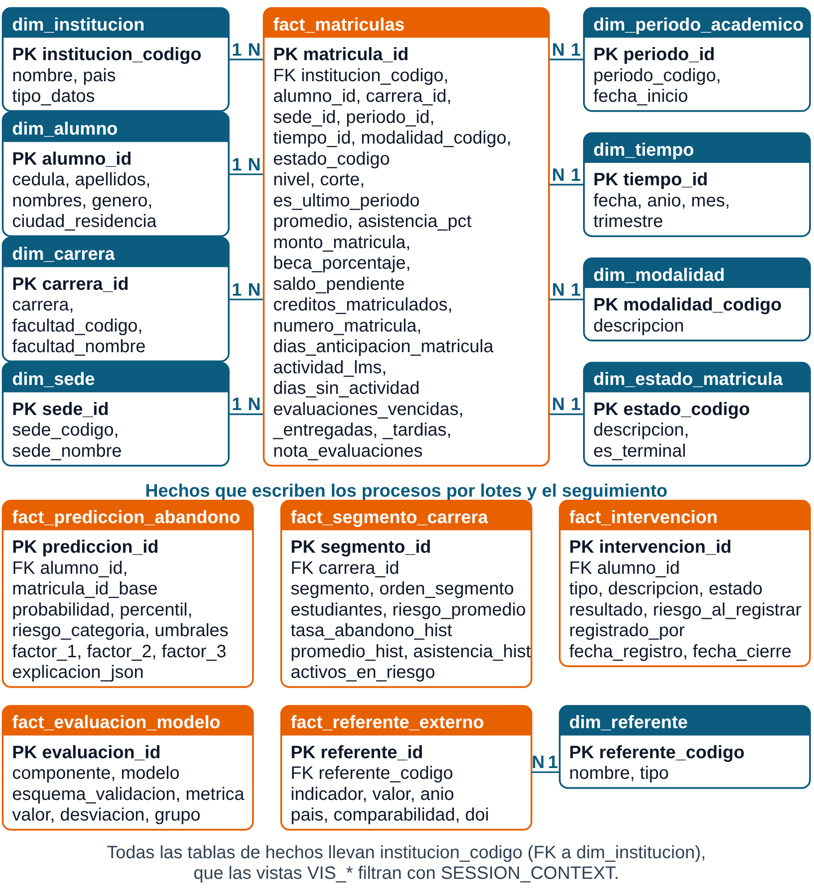<br/><sub>Esquema estrella</sub> |
| 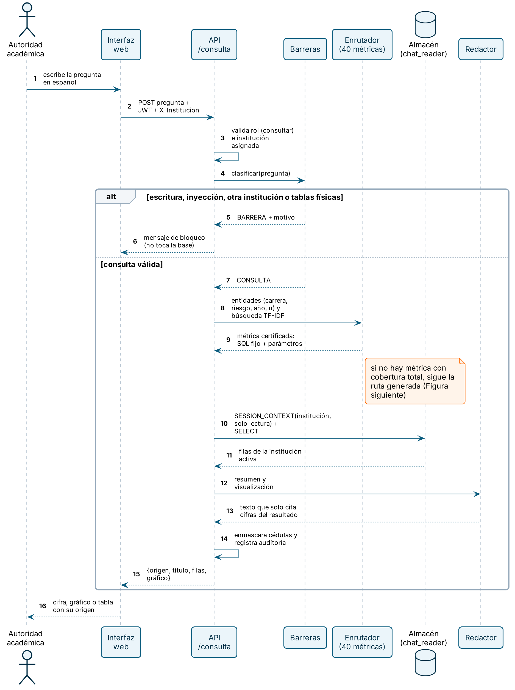<br/><sub>Secuencia de la consulta certificada</sub> | 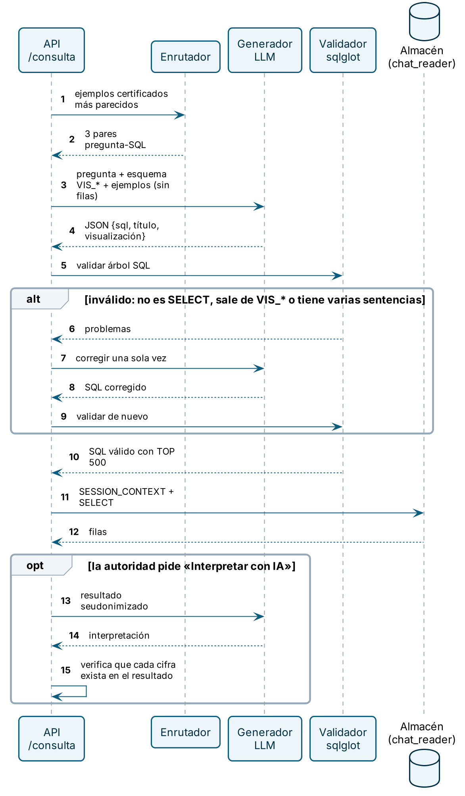<br/><sub>Secuencia de la consulta generada</sub> |
| 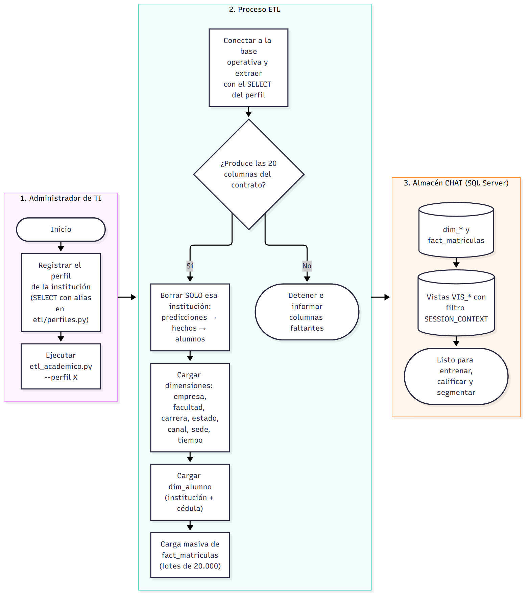<br/><sub>Actividades del ETL</sub> | 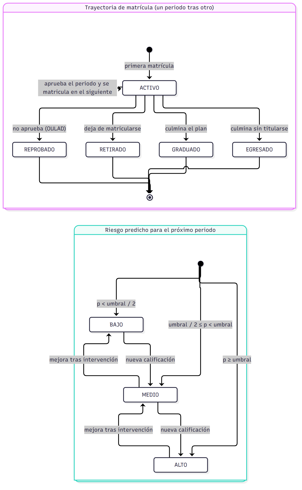<br/><sub>Estados de la alerta y la intervención</sub> |
| 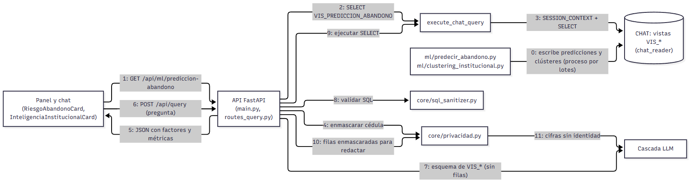<br/><sub>Colaboración de la calificación</sub> | 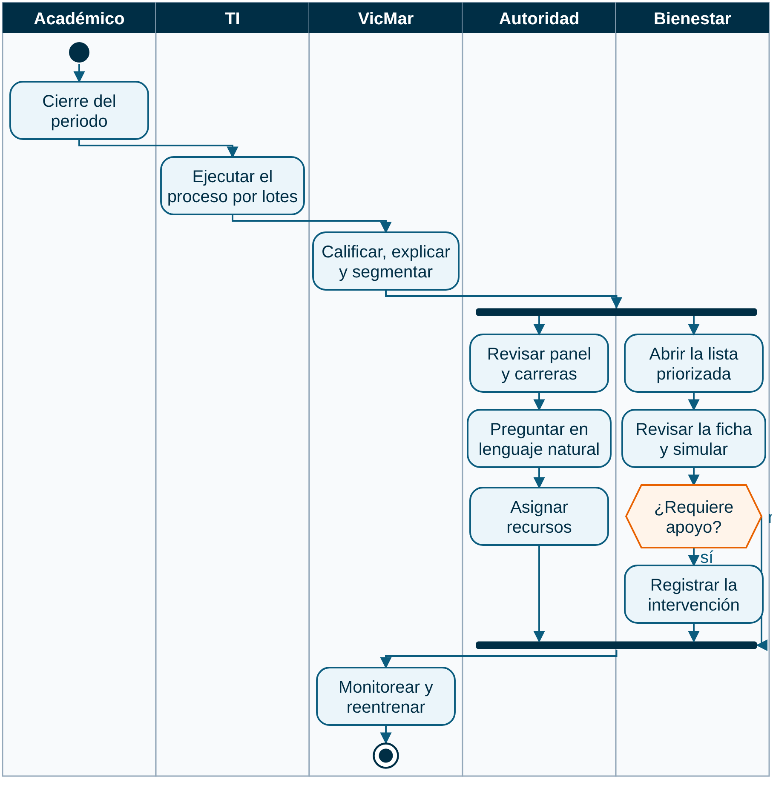<br/><sub>Flujo de trabajo</sub> |

</details>

## Protección de datos

| Principio (LOPDP) | Control |
|---|---|
| Minimización | El modelo no usa nombres ni cédula; las vistas exponen solo lo necesario |
| Aislamiento | Vistas filtradas por `SESSION_CONTEXT('institucion_activa')`; `chat_reader` solo lee vistas; `app_seguimiento` solo ejecuta dos procedimientos |
| Confidencialidad | Cédula enmascarada en pantalla, ficha identificada con token Fernet y datos personales seudonimizados si se pide a la IA interpretar un resultado |
| Seguridad | Contraseñas bcrypt, JWT con vencimiento, bloqueo tras intentos fallidos |
| Responsabilidad | Auditoría de ingresos, fichas, consultas (con huella del SQL) y exportaciones |

## Instalación

**Requisitos:** Windows 10/11, Docker Desktop, Python 3.13 o 3.14 y Node.js 20 o superior.

**Ejecutar el sistema (un solo comando, desde la raíz):**

```bat
git clone https://github.com/Vm199524/PROYECTO-TITULACION-MARLON-VICTOR-UNEMI.git
cd PROYECTO-TITULACION-MARLON-VICTOR-UNEMI
npm start                   &REM o doble clic en iniciar.bat
```

`npm start` crea el entorno virtual de Python si falta, instala las dependencias del backend y de la web (solo cuando cambian), inicia el contenedor de SQL Server si hay Docker y levanta la API (http://localhost:8090/docs) y la aplicación (http://localhost:3000) en la misma consola; `Ctrl+C` detiene ambas. La primera vez crea `backend\.env` desde `.env.example`: complete contraseñas, `JWT_SECRET_KEY` y las claves de IA.

**Primera carga de datos o reconstrucción completa:**

```bat
npm run reconstruir -- --con-consulta      &REM equivale a scripts\reconstruir_sistema.bat --con-consulta
```

- `reconstruir_sistema.bat` crea el entorno virtual, instala dependencias, inicia SQL Server en Docker (contenedor `vicmar-sqlserver`; servidor y puerto según `DB_HOST` del `.env`) y ejecuta el pipeline: bases operativas, almacén y cuentas, ETL, referentes, entrenamiento, calificación, segmentación, reportes, diccionario, cuentas de demostración, pruebas y (con `--con-consulta`) la evaluación del conjunto dorado. Opciones: `--rapido`, `--desde PASO`, `--solo PASO1,PASO2`, `--sin-oulad`, `--reentrenar INST1,INST2`.
- `scripts\levantar_sistema.bat` sigue disponible: abre la API y la aplicación en dos ventanas separadas.
- Las cuentas de demostración `autoridad.demo`, `bienestar.demo` y `admin.ti` se crean con contraseñas aleatorias que solo se guardan en `backend/datos_locales/usuarios_demo.local.json` (fuera del repositorio).
- OULAD se descarga de su sitio oficial (licencia CC BY 4.0) y no se redistribuye aquí; sin esos archivos, use `--sin-oulad`.

**Pruebas**

```bash
npm test                                    # backend (pytest) y frontend (vitest)
cd backend && venv\Scripts\python -m pytest -q   # 170 pruebas + 8 de integración con SQL Server
cd frontend && npm test                     # 11 pruebas de la interfaz
```

## Estructura del repositorio

```
package.json          npm start: arranque único del sistema
iniciar.bat           lo mismo con doble clic
ARQUITECTURA.md       capas y reglas de dependencia del código
backend/              API FastAPI, ETL, modelos (ml/), consulta conversacional (nl2sql/), pruebas y evaluación (eval/)
frontend/             Aplicación React + TypeScript
base_de_datos/        Script del almacén y datos de prueba (simulador UNEMI)
scripts/              iniciar.mjs, reconstruir_sistema.bat, levantar_sistema.bat y demo_tesis.ps1
datos/                Datos externos (OULAD, se descargan aparte)
documentacion/
├── avances/          AVANCE1, AVANCE2 y TRABAJO_FINAL (docx y pdf)
├── generador_documentos/  Generación del trabajo final, la presentación y los guiones desde los resultados reales
├── gobierno_datos/   Documento de gobierno de datos (LOPDP)
├── presentacion/     Presentación del video, guion y guía de sustentación
├── diagramas/        UML, arquitectura y esquema estrella (PNG y fuentes)
├── figuras/          Figuras de validación de cada institución
├── capturas/         Capturas del sistema
├── manuales/         Manual de usuario, manual técnico y guía de pruebas
├── evidencias/       Resultados de la consulta conversacional y latencias
├── decisiones/       Decisiones técnicas y de arquitectura (ADR)
├── literatura/       Trabajos previos y referencias (RIS)
└── tecnica/          Diccionario de datos y notas técnicas
```

## Documentación

- 📄 [Trabajo final (PDF)](documentacion/avances/TRABAJO_FINAL_MARLON_VICTOR.pdf) · [DOCX](documentacion/avances/TRABAJO_FINAL_MARLON_VICTOR.docx) · [Avance 2 (PDF)](documentacion/avances/AVANCE2_MARLON_VICTOR.pdf)
- 🛡️ [Gobierno de datos (LOPDP)](documentacion/gobierno_datos/GOBIERNO_DE_DATOS.md) · [Metabase como alternativa de consulta](documentacion/tecnica/METABASE_ALTERNATIVA_DE_CONSULTA.md)
- 🎤 [Presentación](documentacion/presentacion/Presentacion_Trabajo_Final_Marlon_Victor.pptx) · [Guion del video](documentacion/presentacion/GUION_VIDEO.md) · [Guía de sustentación](documentacion/presentacion/GUIA_SUSTENTACION.md)
- 📘 [Manual de usuario](documentacion/manuales/MANUAL_DE_USUARIO.md) · [Manual técnico de instalación](documentacion/manuales/MANUAL_TECNICO_DE_INSTALACION.md) · [Guía de pruebas de aceptación](documentacion/manuales/GUIA_DE_PRUEBAS_DE_ACEPTACION.md)
- 🗃️ [Diccionario de datos](documentacion/tecnica/DICCIONARIO_DE_DATOS.md) · [Decisiones técnicas](documentacion/decisiones/)

## Cómo citar

GitHub muestra el botón **«Cite this repository»** a partir de [`CITATION.cff`](CITATION.cff). En APA 7:

> Pérez Almachi, M. D., y Lluilema Pisco, V. M. (2026). *Prototipo de un sistema web para predecir el abandono en estudiantes universitarios mediante aprendizaje automático y consulta conversacional* (Versión 3.0.0) [Software]. Universidad Estatal de Milagro. https://github.com/Vm199524/PROYECTO-TITULACION-MARLON-VICTOR-UNEMI

## Licencia

Mientras dure el proceso de titulación, el uso de este repositorio está restringido a sus autores y a la Universidad Estatal de Milagro. La licencia definitiva la establecerá la UNEMI al liberar el proyecto. Los datos de UNEMI_PRUEBAS son sintéticos; OULAD se usa bajo licencia CC BY 4.0 y no se redistribuye.

## Autores

<table align="center">
<tr>
<td align="center" width="50%">
<a href="https://github.com/ing-MarlonPerez"></a><br/>
<b>Marlon David Pérez Almachi</b><br/>
<sub>Autor · <a href="https://github.com/ing-MarlonPerez">@ing-MarlonPerez</a></sub>
</td>
<td align="center" width="50%">
<a href="https://github.com/Vm199524"></a><br/>
<b>Víctor Manuel Lluilema Pisco</b><br/>
<sub>Autor · <a href="https://github.com/Vm199524">@Vm199524</a></sub>
</td>
</tr>
</table>

<p align="center">
  <a href="#readme-top">
    <picture>
      <source media="(prefers-color-scheme: dark)" srcset=".github/assets/footer-dark.svg">
      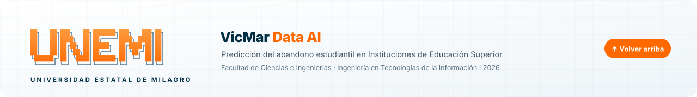
    </picture>
  </a>
</p>
