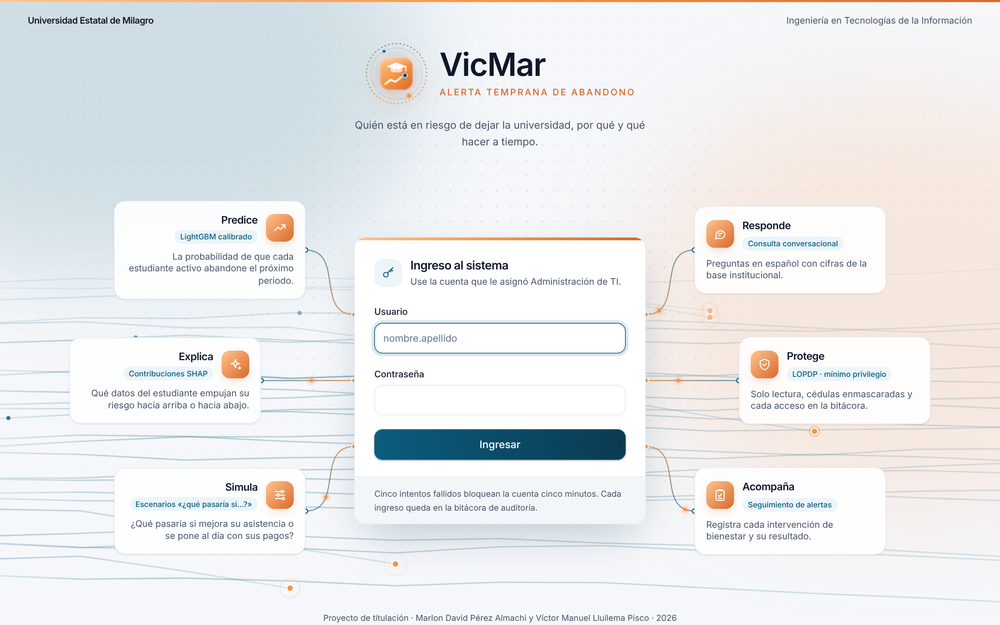

# Manual de usuario

**Sistema:** VicMar · alerta temprana del abandono en estudiantes universitarios con aprendizaje automático y consulta conversacional
**Versión del documento:** 3.0 · octubre de 2026 (corresponde a la versión 3 del prototipo)
**Autores:** Marlon David Pérez Almachi · Víctor Manuel Lluilema Pisco
**Institución:** Universidad Estatal de Milagro · Facultad de Ciencias e Ingenierías

**Para quién es:** autoridades académicas, personal de bienestar estudiantil y administración de TI que usan el
sistema desde el navegador. No hace falta ningún conocimiento técnico.

---

## 1. Para qué sirve

VicMar estima, para cada estudiante con matrícula vigente, la **probabilidad de que abandone sus estudios en el próximo periodo**, explica las tres razones que más pesan en esa estimación, sugiere acciones de acompañamiento y permite consultar las cifras de la institución **escribiendo preguntas en español**, sin conocimientos técnicos.

| Si usted necesita… | Use |
|---|---|
| Ver de un vistazo cómo está la institución | **Panel ejecutivo** (sección 4) |
| Saber a quién atender primero | **Estudiantes en riesgo** (sección 5) |
| Entender por qué un estudiante está en riesgo | **Ficha del estudiante** (sección 6) |
| Registrar una tutoría, consejería o apoyo | **Seguimiento** (sección 7) |
| Responder una pregunta puntual | **Consulta conversacional** (sección 8) |
| Decidir qué carreras priorizar | **Carreras** (sección 9) |
| Comparar con otras universidades | **Referentes externos** (sección 10) |
| Saber cuánto confiar en el modelo | **Calidad del modelo** (sección 11) |
| Llevar las cifras a una reunión | **Reportes ejecutivos** (sección 12) |

> **Importante.** VicMar no decide nada por usted. Ordena y explica el riesgo para que bienestar estudiantil y las autoridades actúen a tiempo; la decisión de intervenir es siempre de una persona.

## 2. Ingresar

Abra el navegador en la dirección que le indicó Administración de TI (en la instalación de prueba, `http://localhost:3000`). La pantalla de apertura dibuja el emblema de VicMar y muestra las seis capacidades del sistema alrededor del formulario.

1. Escriba su **usuario** (`nombre.apellido`) y su **contraseña**.
2. Pulse **Ingresar**. El sistema abre la primera pantalla que su rol puede ver.

Cinco intentos fallidos seguidos bloquean la cuenta durante cinco minutos, y cada ingreso queda en la bitácora de auditoría. Si olvidó su contraseña, pídale a Administración de TI que la restablezca.

### Roles

| Rol | Qué puede hacer |
|---|---|
| **Autoridad académica** | Panel, estudiantes y fichas, carreras, referentes, calidad del modelo, consulta conversacional, reportes y lectura del seguimiento |
| **Bienestar estudiantil** | Todo lo anterior salvo la calidad del modelo, y además el simulador «¿qué pasaría si…?» y el **registro y cierre de intervenciones** |
| **Administración de TI** | Todo lo anterior, y además cuentas de usuario, auditoría, estado del sistema y el SQL de las respuestas |

Las opciones que su rol no permite no aparecen en el menú.

## 3. La pantalla

- **Barra lateral (izquierda):** el menú agrupado por proceso: *Inicio*, *Alerta temprana*, *Análisis institucional*, *Confianza*, *Reportes* y *Administración*.
- **Barra superior:** la ruta en la que está (migas de pan), el **selector de institución** (por ejemplo, «UNEMI (datos de prueba)» con la etiqueta *Datos sintéticos*), el botón de **tema claro u oscuro** y su cuenta.
- **Institución activa:** todo lo que ve y pregunta corresponde solo a la institución elegida. Si su cuenta tiene más de una, cámbiela desde el selector; la base de datos impide leer cualquier otra.

## 4. Panel ejecutivo

El panel saluda por su nombre e indica cuándo y con qué modelo se calculó el riesgo.

| Elemento | Qué muestra |
|---|---|
| **Termómetro institucional** | El reparto de los estudiantes activos entre riesgo alto, medio y bajo |
| **En pocas palabras** | Tres frases que resumen el periodo: cuántos están en riesgo, la carrera más afectada y cuántas carreras quedaron en atención prioritaria |
| **Indicadores** | Estudiantes evaluados, riesgo alto, riesgo medio, abandono histórico y porcentaje del riesgo alto que ya tiene seguimiento |
| **Estudiantes en riesgo por carrera** | Las carreras con más estudiantes en riesgo alto y medio |
| **Atender primero** | Los estudiantes con la probabilidad más alta; pulse uno para abrir su ficha |
| **Abandono por periodo académico** | Matriculados y retiros de cada periodo |
| **Confiabilidad del modelo** | Cuántos abandonos anticipa el sistema y cuántas alertas terminaron en abandono, en palabras sencillas |

Los botones **Reporte PDF** y **Ver estudiantes en riesgo** llevan directamente al reporte o a la lista.

## 5. Estudiantes en riesgo

La lista ordena a los estudiantes con matrícula vigente por su **probabilidad de abandonar en el próximo periodo**.

- **Filtros:** *En riesgo* (alto y medio), *Alto*, *Medio*, *Bajo* o *Todos*; la carrera; y la búsqueda por apellidos o nombres.
- **Columnas:** estudiante (con la cédula enmascarada), carrera y nivel, promedio, asistencia, probabilidad, nivel de riesgo y las principales razones.
- Pulse el nombre para abrir la **ficha**.

**Cómo leer el nivel de riesgo.** El umbral **medio** está fijado para no dejar fuera a casi nadie que vaya a abandonar (detecta cerca de 8 de cada 10); el umbral **alto** reúne a los casos más probables y sirve para organizar el contacto directo según la capacidad de bienestar.

## 6. Ficha del estudiante

| Parte | Para qué sirve |
|---|---|
| **Riesgo de abandono** | Probabilidad, nivel, posición dentro de la institución y versión del modelo |
| **Razones** | Los factores que más **aumentan** o **reducen** el riesgo de este estudiante, en lenguaje sencillo (rendimiento académico, asistencia, situación económica, repetición, entregas, aula virtual, carga académica) |
| **Acciones sugeridas** | Reglas de acompañamiento según las razones; cada una tiene **Registrar** para convertirla en una intervención |
| **¿Qué pasaría si…?** | *(Bienestar y TI)* Mueva promedio, asistencia, saldo, actividad en el aula virtual o entregas y pulse **Recalcular riesgo**: el mismo modelo muestra el riesgo *Ahora* y *Con los cambios*. No modifica ningún dato |
| **Trayectoria académica** | Promedio y asistencia de cada periodo cursado |
| **Historial de seguimiento** | Las intervenciones registradas con este estudiante, abiertas o cerradas |

Si aparece «Sin predicción vigente», el estudiante no tiene matrícula en el periodo actual o el modelo todavía no lo ha calificado.

## 7. Seguimiento

**Registrar una intervención** *(Bienestar y TI)*: desde la ficha, pulse **Registrar intervención** (o **Registrar** en una acción sugerida), elija el tipo y describa lo acordado.

| Tipo | Ejemplo |
|---|---|
| Tutoría académica | Tutoría de Cálculo los martes |
| Consejería | Cita con psicología |
| Apoyo económico | Trámite de beca o plan de pagos |
| Contacto con el estudiante | Llamada o mensaje de seguimiento |
| Derivación a otra instancia | Remisión a la dirección de carrera |

**Cerrar una intervención:** en la ficha o en la pantalla *Seguimiento*, pulse **Cerrar intervención** y anote el resultado (por ejemplo, «Asiste a tutorías y aprobó el parcial»). Así la institución aprende qué acciones funcionan.

La pantalla **Seguimiento** lista las 300 intervenciones más recientes con su estado. La autoridad académica la consulta en modo de lectura.

## 8. Consulta conversacional

Escriba una pregunta en español y pulse Enter (Mayúsculas + Enter agrega una línea). También puede tocar una de las **Preguntas frecuentes** de la derecha. Ejemplos:

- «¿Qué carreras tienen más estudiantes en riesgo?»
- «¿Cuántos estudiantes de Derecho están en riesgo alto?»
- «¿Cómo evolucionó el abandono por periodo?»
- «¿Qué tan preciso es el modelo?»

Cada respuesta indica **de dónde salió la cifra**:

| Etiqueta | Significado |
|---|---|
| **Métrica certificada** | Consulta fija revisada por los autores; la IA no interviene en la cifra |
| **Generada con IA y validada** | La IA propuso la consulta y el sistema la validó (solo lectura, solo vistas autorizadas) antes de ejecutarla |
| **Barrera de seguridad** | La pregunta no se ejecuta contra la base de datos |
| **Sin respuesta** | No se encontró cómo responder con los datos disponibles |

Con la respuesta en pantalla puede:
- pulsar **Interpretar con IA** para obtener una lectura en palabras; la marca *Cifras verificadas* indica que los números del texto coinciden con la tabla;
- descargar la tabla en **Excel**;
- *(TI)* pulsar **Ver SQL** para revisar la consulta ejecutada.

### Lo que la consulta no hace

Solo **lee**. Si se le pide borrar, cambiar o agregar datos, o mostrar información de otra institución, responde con una barrera de seguridad y no ejecuta nada. Las cédulas siempre se muestran enmascaradas.

## 9. Carreras

Las carreras se agrupan por su abandono histórico, rendimiento, asistencia y riesgo actual. Los segmentos se ordenan por el riesgo combinado (el abandono que ya ocurrió y el que el modelo anticipa); el primero es el de **atención prioritaria**.

- **Mapa de carreras:** cada punto es una carrera; el tamaño indica el número de estudiantes.
- **¿Qué tan sólida es la agrupación?:** la calidad de la separación y la comparación con otros algoritmos, explicadas en palabras.
- **Detalle por carrera:** pulse una carrera para ver sus estudiantes.

## 10. Referentes externos

Muestra la tasa de abandono de la institución activa junto a las publicadas en estudios con revisión de pares. Lea el **nivel de comparabilidad** antes de sacar conclusiones: las definiciones de abandono no siempre coinciden.

## 11. Calidad del modelo

*(Autoridad y TI.)* Resume cómo se validó el modelo de la institución activa:
- **Modelos comparados** con validación cruzada agrupada por estudiante;
- **Matrices de confusión** en los umbrales medio y alto;
- curvas **ROC**, **precisión y exhaustividad** y **calibración** («cerca de la diagonal, la probabilidad dice la verdad»);
- **equidad** por subgrupo, **exactitud por tema** de la consulta conversacional, **pruebas de ataque** y la **ficha del modelo** (para qué sirve, para qué no y cómo se controla).

## 12. Reportes ejecutivos

Descargue el estado del riesgo de la institución activa:
- **Reporte ejecutivo en PDF** para reuniones;
- **Libro de Excel** con el detalle para análisis.

Se generan al momento con los datos vigentes, con las cédulas enmascaradas, y la descarga queda registrada en la auditoría.

## 13. Mi cuenta

En el menú de su cuenta, **Mi cuenta** muestra su usuario, rol e instituciones, y permite **cambiar la contraseña** (mínimo 8 caracteres; se pide la actual).

## 14. Administración de TI

| Pantalla | Qué permite |
|---|---|
| **Usuarios y roles** | Crear cuentas (**Nueva cuenta**, con contraseña inicial de al menos 8 caracteres), editar nombre, correo, rol e instituciones, activar o desactivar, asignar una nueva contraseña y eliminar |
| **Auditoría** | Los 500 eventos más recientes: ingresos y rechazos, fichas abiertas, simulaciones, consultas (con la huella del SQL), exportaciones, intervenciones y altas, cambios y bajas de cuentas; filtrable por usuario y acción |
| **Estado del sistema** | Carga de datos, modelo y calificación de cada institución, alertas de **deriva** de las variables, proveedores de IA configurados y la última corrida de los procesos por lotes |

## 15. En el teléfono

La aplicación se adapta a la pantalla del teléfono: el menú se abre con el botón de la esquina superior y la lista de estudiantes pasa a tarjetas.

  
  &nbsp;
  

## 16. Problemas frecuentes

| Situación | Qué hacer |
|---|---|
| «Usuario o contraseña incorrectos» | Revise mayúsculas; tras cinco intentos espere cinco minutos o pida a TI que restablezca la clave |
| El panel dice «Todavía no hay estudiantes calificados» | Los procesos por lotes no se han ejecutado para esa institución: avise a TI (lo ve en *Estado del sistema*) |
| No aparece una opción del menú | Su rol no la incluye (sección 2) |
| La consulta responde «Sin respuesta» | Reformule con palabras del menú (carrera, riesgo, periodo, nivel) o use una pregunta frecuente |
| Aviso de proveedor de IA no disponible | Se agotó la cuota del proveedor: las métricas certificadas y todas las pantallas siguen funcionando |
| Una cifra de la consulta no coincide con el panel | El panel es la referencia; reformule la pregunta y avise a TI |

## 17. Cuidado de los datos

VicMar aplica la Ley Orgánica de Protección de Datos Personales del Ecuador: el modelo no usa nombres ni cédulas, las cédulas se muestran enmascaradas, cada institución ve solo sus datos y cada acceso a información de estudiantes queda registrado. No comparta su cuenta ni descargue reportes en equipos públicos.
