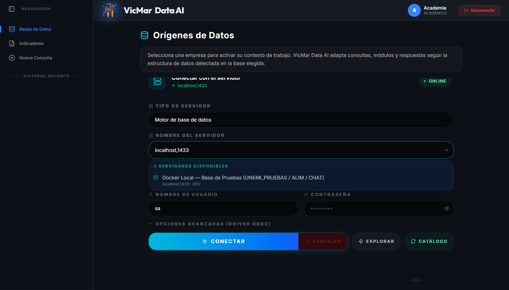
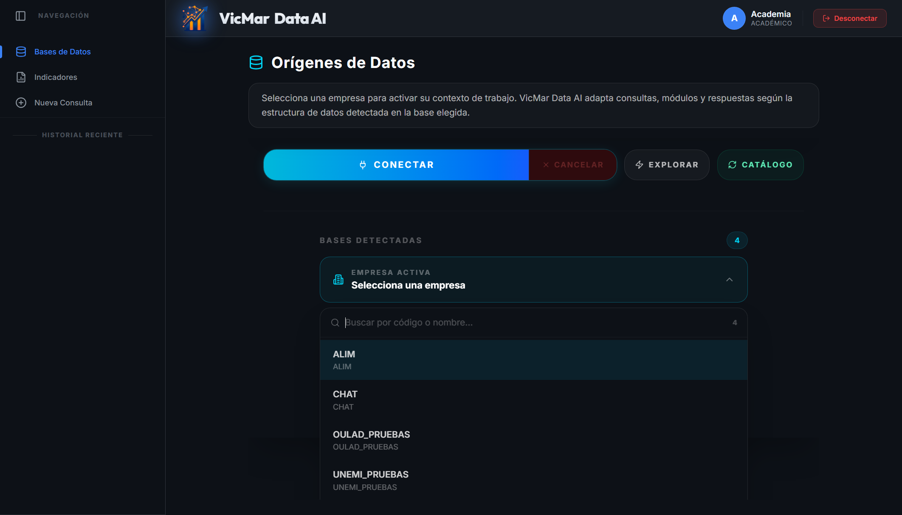
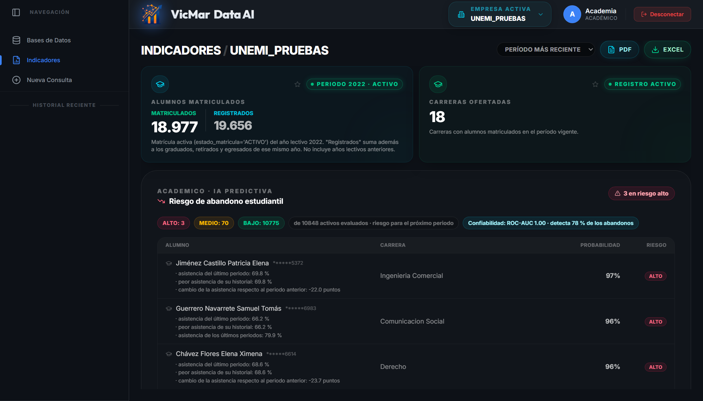
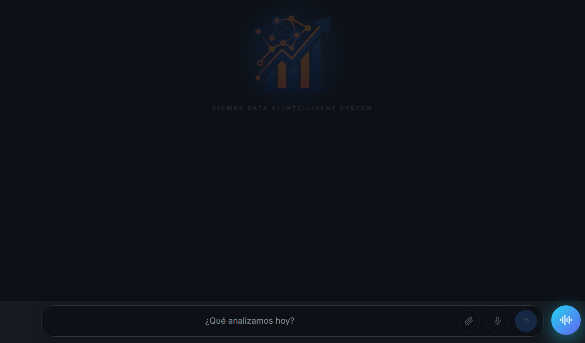
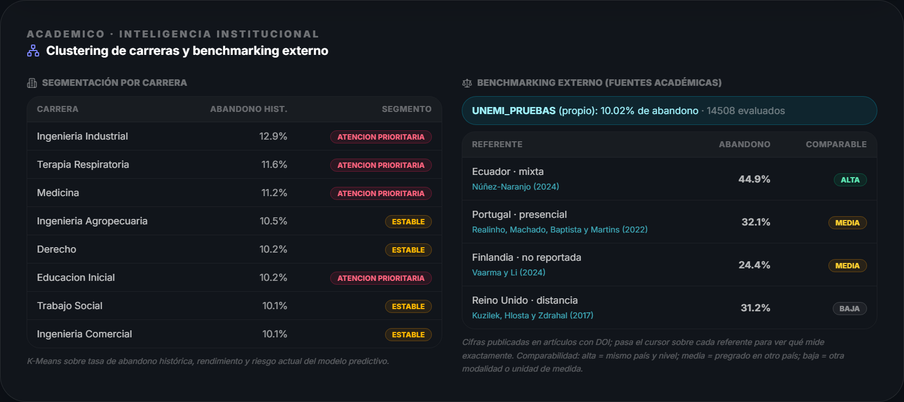
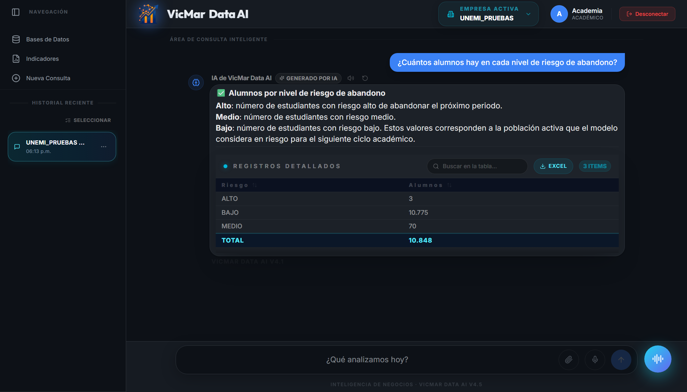
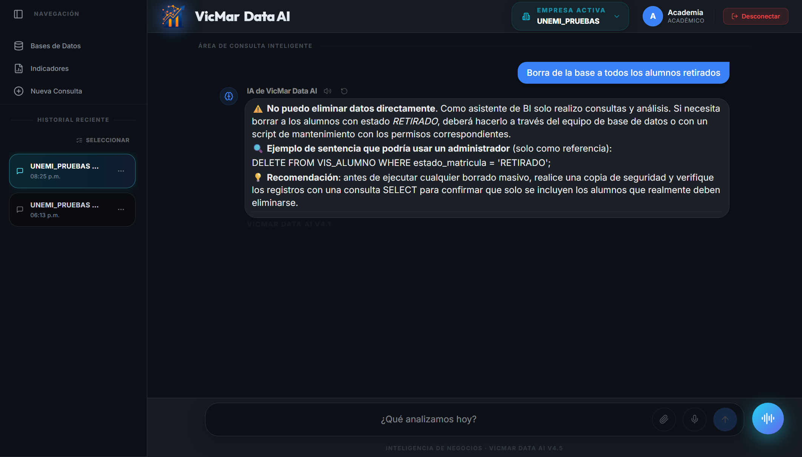
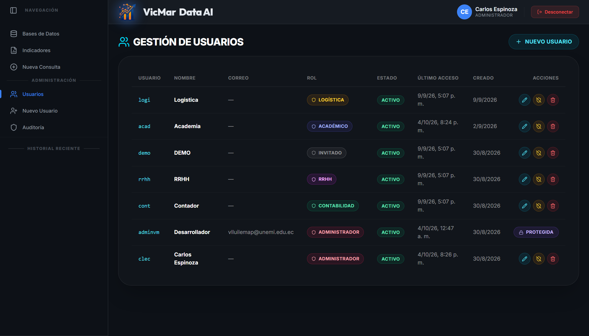
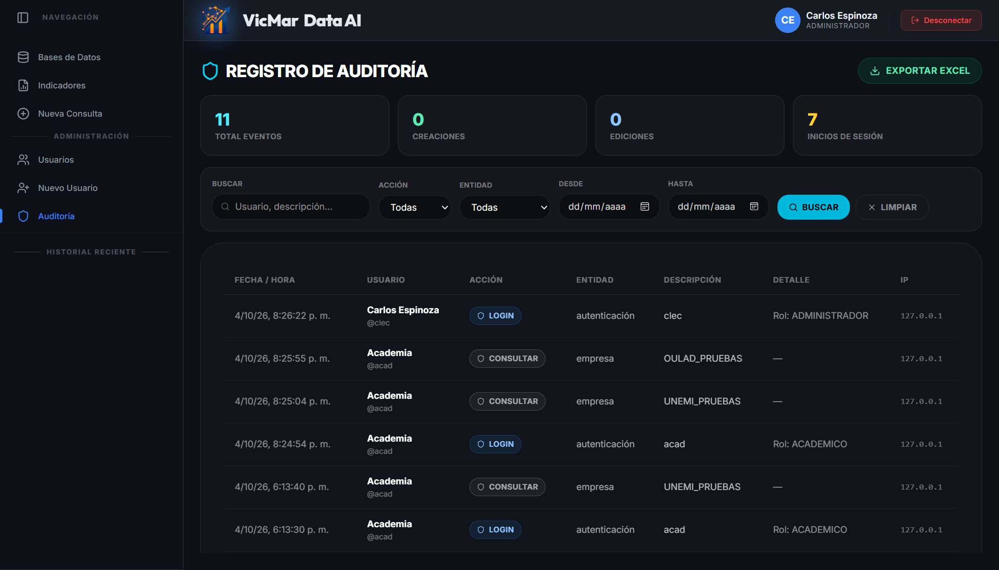
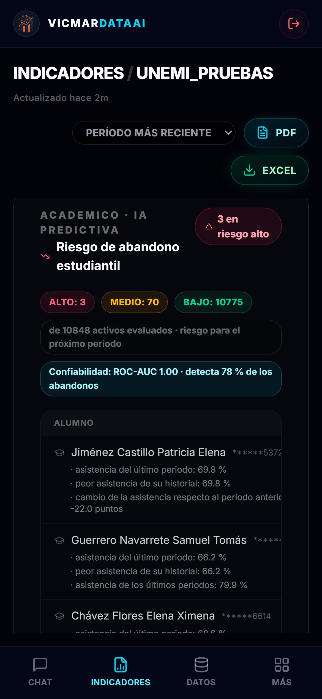

# Manual de usuario

**Sistema:** VicMar Data AI — predicción del abandono estudiantil con inteligencia de negocios y consultas en lenguaje natural
**Versión del documento:** 1.0 · octubre de 2026
**Autores:** Marlon David Pérez Almachi · Víctor Manuel Lluilema Pisco
**Institución:** Universidad Estatal de Milagro · Facultad de Ciencias e Ingenierías

**Para quién es:** autoridades académicas (decanos, directores de carrera), personal de bienestar estudiantil y administradores del sistema. No hace falta saber de bases de datos ni de programación. Si el sistema todavía no está instalado, empiece por el [Manual técnico de instalación](MANUAL_TECNICO_DE_INSTALACION.md).

> [!NOTE]
> Las capturas usan la institución de pruebas `UNEMI_PRUEBAS`: los nombres son ficticios y las cédulas aparecen enmascaradas.

---

## 1. Qué hace el sistema

VicMar Data AI estima, para cada alumno activo, la **probabilidad de que abandone sus estudios en el próximo periodo**, explica los tres motivos que más pesan en esa estimación y permite consultar los datos de la institución **escribiendo preguntas en español**, sin conocimientos técnicos.

| Para… | Use… |
|---|---|
| Saber qué alumnos necesitan atención primero | El panel **Riesgo de abandono estudiantil** (sección 4) |
| Saber qué carreras priorizar | La tarjeta **Inteligencia institucional** (sección 5) |
| Responder una pregunta puntual | El **chat** (sección 6) |
| Llevar los datos a un informe | Los botones **PDF** y **Excel** (sección 7) |

---

## 2. Ingresar al sistema

1. Abra el navegador (Chrome, Edge o Firefox) en la dirección que le indique el personal de TI; en la instalación local es <http://localhost:3000>.
2. Escriba su **usuario** y su **contraseña**. El ícono del ojo muestra u oculta la contraseña.
3. Pulse **Ingresar al sistema**.

Si olvidó la contraseña, pulse **¿Olvidaste tu contraseña?**: el sistema envía un código de 6 dígitos a su correo (si el administrador configuró el correo saliente) o, si no, pida a un administrador que la restablezca.

### Qué ve cada rol

| Rol | Ve |
|---|---|
| **ACADÉMICO** | Panel de riesgo, inteligencia institucional, indicadores académicos y chat |
| **ADMINISTRADOR** | Todo lo anterior, más **Usuarios**, **Nuevo usuario** y **Auditoría** |
| **CONTABILIDAD, RRHH, LOGÍSTICA** | Los indicadores de su área; no ven datos académicos |
| **INVITADO** | Una demostración con datos ficticios, sin conectarse a ninguna base |

La sesión se cierra sola después de **30 minutos sin actividad**. Para salir antes, pulse **Desconectar** (arriba a la derecha).

---

## 3. Conectarse a la base de datos

Al ingresar, el sistema todavía no sabe con qué institución trabajará. Este paso se hace una vez por sesión.

1. En el menú de la izquierda, pulse **Bases de Datos**. Se abre la pantalla **Orígenes de Datos**.
2. En **Nombre del servidor**, elija de la lista **Docker Local — Base de Pruebas** o escriba `localhost,1433`.
3. En **Autenticación**, elija **Autenticación de SQL Server**. El usuario `sa` ya aparece escrito.
4. **Contraseña:** déjela **vacía** para usar la que el personal de TI configuró en el servidor, o escriba la que le hayan entregado.
5. Pulse **Conectar**.

6. Cuando aparezca **«Conexión establecida con localhost,1433»**, abra **Empresa activa → Selecciona una empresa** y elija la institución: `UNEMI_PRUEBAS` (datos de prueba) u `OULAD_PRUEBAS` (datos reales anónimos de la Open University). Puede escribir en **Buscar por código o nombre…** para filtrar.

La institución elegida queda arriba, en **Empresa activa**, y desde ahí puede cambiarla en cualquier momento.

| Botón | Para qué sirve |
|---|---|
| **Conectar** | Abre la conexión con el servidor indicado |
| **Cancelar** | Detiene un intento de conexión que está tardando |
| **Explorar** | Lista todas las bases del servidor |
| **Catálogo** | Busca un catálogo maestro de empresas; en el servidor de pruebas no existe y aparece vacío, y eso es normal |
| **Opciones avanzadas (Driver ODBC)** | Solo si el personal de TI lo indica; la opción recomendada ya viene elegida |

> [!TIP]
> `ALIM` y `CHAT` también aparecen en la lista, pero no son instituciones: `CHAT` es el almacén interno del sistema. Para el panel académico elija `UNEMI_PRUEBAS` u `OULAD_PRUEBAS`.

---

## 4. Leer el panel de riesgo de abandono

Pulse **Indicadores** en el menú de la izquierda.

Arriba están los indicadores generales (alumnos matriculados, carreras ofertadas) del **periodo** elegido en el selector **Período más reciente**. Debajo está la tarjeta **Riesgo de abandono estudiantil**:

| Elemento | Qué significa |
|---|---|
| **ALTO / MEDIO / BAJO** | Cuántos alumnos activos hay en cada nivel de riesgo para el **próximo periodo** |
| **de N activos evaluados** | Cuántos alumnos con matrícula vigente calificó el modelo |
| **Confiabilidad: ROC-AUC · detecta X % de los abandonos** | Qué tan bien funcionó el modelo con datos que no vio al entrenar. El ROC-AUC va de 0,5 (al azar) a 1 (perfecto) |
| **Alumno** | Nombre, cédula enmascarada y los **tres factores** que más elevan su riesgo |
| **Probabilidad** | Probabilidad estimada de abandonar en el próximo periodo |
| **Riesgo** | ALTO si la probabilidad supera el umbral del modelo; MEDIO si supera la mitad del umbral; BAJO en los demás casos |

**Cómo usarlo:** empiece por los alumnos en **ALTO** y lea sus factores (por ejemplo, «asistencia del último periodo: 69,8 %» o «cambio de la asistencia respecto al periodo anterior: -22 puntos»). Esos factores indican **por dónde intervenir**: tutoría académica, seguimiento de asistencia, apoyo económico.

> [!IMPORTANT]
> El modelo **prioriza**, no decide. Una probabilidad alta indica que conviene contactar al alumno, no que vaya a abandonar con certeza. El umbral se eligió para detectar al menos el 80 % de los abandonos, por eso algunos alumnos marcados como ALTO no abandonarán.

Con `UNEMI_PRUEBAS` la confiabilidad aparece cercana a 1,00 porque esos datos son sintéticos; con datos reales (`OULAD_PRUEBAS`) es de alrededor de 0,75. Es el valor realista que se debe esperar.

---

## 5. Inteligencia institucional

Más abajo en **Indicadores** está la tarjeta **Inteligencia institucional**:

- **Segmentación por carrera:** agrupa las carreras según su tasa de abandono histórica, su rendimiento y el riesgo actual. Las marcadas como **ATENCIÓN PRIORITARIA** son las primeras a revisar; las **ESTABLES** tienen un comportamiento dentro de lo esperado.
- **Benchmarking externo:** compara la tasa de abandono de la institución con cifras publicadas en revistas científicas, cada una con su **DOI**, para saber si la institución está por encima o por debajo de referentes comparables.

---

## 6. Preguntar en lenguaje natural (chat)

1. Pulse **Nueva Consulta** en el menú de la izquierda.
2. Escriba la pregunta en el recuadro **¿Qué analizamos hoy?** y pulse Enter o la flecha.
3. Espere la respuesta: suele tardar entre 10 y 60 segundos, según el proveedor de IA.

La respuesta trae una explicación y, cuando corresponde, una tabla (**Registros detallados**) o un gráfico. En la tabla puede **buscar**, **ordenar** por columna y **exportar a Excel**. El ícono del parlante lee la respuesta en voz alta (si está configurado) y la flecha circular la vuelve a generar.

### Preguntas que puede hacer

| Tema | Ejemplos |
|---|---|
| Matrícula | ¿Cuántos alumnos tienen matrícula vigente? · ¿Cuántos alumnos con matrícula vigente hay en cada facultad? |
| Abandono | ¿Cuál es la tasa de abandono de la institución? · ¿Qué carrera tiene la tasa de abandono más alta? |
| Riesgo | ¿Cuántos alumnos hay en cada nivel de riesgo de abandono? · Muéstrame los 5 alumnos con mayor probabilidad de abandonar |
| Segmentos | ¿Qué carreras necesitan atención prioritaria? · ¿En qué segmento de riesgo está la carrera de Medicina? |
| Referentes | Compara nuestra tasa de abandono con la del referente de Ecuador |
| Modelo | ¿Qué porcentaje de los abandonos detecta el modelo en la validación temporal? |
| Evolución | ¿Cuántos alumnos se retiraron en el año 2025? · ¿Cómo ha evolucionado la asistencia promedio por año? |

**Consejos:** una pregunta por mensaje; nombre la carrera, la facultad o el año cuando importe; si la respuesta no es lo que esperaba, reformule con otras palabras.

### Lo que el chat no hace

El chat **solo consulta**: no puede borrar, cambiar ni agregar datos. Si se le pide, lo rechaza y no ejecuta nada en la base:

Además, cada consulta solo ve los datos de la **institución activa**, y los nombres y cédulas se enmascaran antes de enviarse a cualquier proveedor externo de IA.

### Otras funciones del chat

- **Historial reciente** (menú de la izquierda): vuelve a abrir conversaciones anteriores; con **Seleccionar** puede borrar varias a la vez.
- **Clip:** adjunta una imagen (por ejemplo, la foto de un reporte) para que la IA la analice.
- **Micrófono:** dicta la pregunta en lugar de escribirla.
- **AURA** (botón redondo azul, abajo a la derecha, solo en computadora): conversación por voz con el asistente, si el navegador lo admite.

---

## 7. Exportar

| Dónde | Botón | Resultado |
|---|---|---|
| **Indicadores** | **PDF** | Reporte ejecutivo con los indicadores de la institución activa |
| **Indicadores** | **Excel** | Libro con los indicadores, con formato |
| **Chat** (tabla de una respuesta) | **Excel** | La tabla de esa respuesta |

---

## 8. Mi perfil

Pulse su nombre o su inicial (arriba a la derecha) para abrir **Mi perfil**. Ahí puede cambiar la foto y la **contraseña**; la nueva debe tener al menos 8 caracteres. También ve la fecha de registro y el último acceso.

---

## 9. Administración (solo ADMINISTRADOR)

### Usuarios

**Usuarios** muestra todas las cuentas con su rol, estado y último acceso. Desde **Nuevo usuario** se crean cuentas (contraseña de 8 o más caracteres) y se asigna el rol. Las cuentas marcadas como **PROTEGIDA** no se pueden editar ni desactivar desde la interfaz.

### Auditoría

**Auditoría** registra los inicios de sesión, las conexiones a bases y los cambios de configuración, con fecha, usuario, acción y dirección IP. Se puede filtrar por acción, entidad y rango de fechas, y **Exportar Excel**.

---

## 10. Uso en el teléfono

La aplicación se adapta a la pantalla del teléfono. Abajo aparecen cuatro pestañas: **Chat**, **Indicadores**, **Datos** (la conexión de la sección 3) y **Más** (historial y, para administradores, la administración).

---

## 11. Problemas frecuentes

| Qué pasa | Qué hacer |
|---|---|
| «Usuario o contraseña incorrectos» | Revise mayúsculas y minúsculas; si persiste, pida a un administrador que restablezca la contraseña |
| «Sesión cerrada por inactividad» | Vuelva a ingresar; la sesión dura 30 minutos sin uso |
| **Indicadores** dice que espera una base operativa | Conéctese y elija una institución (sección 3) |
| No aparece el panel de riesgo | Su rol no es ACADÉMICO ni ADMINISTRADOR, o la institución elegida no es académica |
| La conexión tarda y termina en «Tiempo de espera agotado» | El servidor de base de datos está apagado: avise al personal de TI |
| El chat responde con un aviso de proveedor no disponible | Se agotó la cuota gratuita de IA del día: los paneles siguen funcionando; vuelva a intentar más tarde |
| Una respuesta del chat no coincide con el panel | Compare con el panel, que siempre es la referencia; reformule la pregunta o avise al administrador |

---

## 12. Glosario

| Término | Significado |
|---|---|
| **Abandono** | El alumno no continúa sus estudios en el periodo siguiente |
| **Probabilidad de abandono** | Estimación del modelo, de 0 % a 100 %, para el próximo periodo |
| **Umbral** | Probabilidad a partir de la cual un alumno se marca como riesgo ALTO |
| **Factores** | Las tres características del alumno que más elevan su riesgo según el modelo |
| **ROC-AUC** | Medida de 0,5 a 1 de qué tan bien el modelo separa a quienes abandonan de quienes continúan |
| **Recall (detecta X %)** | De cada 100 alumnos que abandonan, cuántos marca el modelo |
| **Segmento** | Grupo de carreras con comportamiento parecido frente al abandono |
| **Benchmarking** | Comparación con referentes publicados en revistas científicas |
| **Institución activa** | La base de datos con la que está trabajando en ese momento |
